# LLM Comparison Progress Log

This file compares the five models used in the free-tier simulator work, one
topic at a time: mirroring, separability from real writing, and the Q1
hierarchy effect. Each section holds every model's numbers together, so they
can be read at once.

`PROGRESS_nvidia.md` still holds the day-by-day build log: what was tried,
what broke, and the exact commit history. This file only reorganizes its
numbers by topic. Most numbers here are not new. The exceptions are the
gpt-oss-20b Q1 grid (Sep 21), the gpt-oss-120b Q1 grid (Sep 22) and the
qwen3.8-27b full Q1 grid, all first reported in the Q1 sections. This work is still a trial. Nothing
here replaces a result in `PROGRESS.md` yet, except where a section says so
directly (the Q1 real-email comparison).

---

## 1. Status at a glance

| | Llama 3.2 3B | DeepSeek V4 Flash | gpt-oss-20b | gpt-oss-120b | qwen3.8-27b |
|---|---|---|---|---|---|
| 183 real-email pairs generated | Yes (see `PROGRESS.md`) | Yes | Yes | Yes | Yes (182 valid) |
| Mirroring measured | Yes | Yes | Yes | Yes | Yes |
| Told apart from real writing (AUC) measured | Yes | Yes | Yes | Yes | Yes |
| Q1 grid (240 replies) generated | Yes | Yes | Yes | Yes | Yes (inside the full grid) |
| Q1 full grid (1,440 cells) generated | Yes | No | Yes | Yes | Yes |
| Q1 checked against the real-email benchmark | Yes | Yes | Yes | Yes | Yes |
| Hand-coded by a person | No | No | No | No | No |

Other open items: a run without the "act" instruction, an embedding map and
review pack for the newer models, and committing the blind-coding module.
See "22. Next steps" at the end.

---

## 2. The models compared

| Model | Family | Reached through | Setting | Notes |
|---|---|---|---|---|
| Llama 3.2 3B | Meta | Local, on this laptop (Ollama) | none | 3B parameters. Runs on 8 GB of memory. |
| DeepSeek V4 Flash | DeepSeek | NVIDIA free tier | none | |
| gpt-oss-20b | OpenAI | NVIDIA free tier | `@low` reasoning effort | Without it, some replies run past the JSON until the token limit. |
| gpt-oss-120b | OpenAI | Groq free tier | `@low` reasoning effort | NVIDIA does not serve this model. This laptop cannot run it: it needs about 60 GB of memory, and the laptop has 16 GB plus 1 GB of graphics memory. |
| qwen3.8-27b | Alibaba (Qwen) | Groq free tier | none | Takes DeepSeek's place in the full Q1 grid, since NVIDIA retired DeepSeek (section 18). Used for the Q1 grid and the Q2 pairs. A writer only in the judge swap: as a judge it fails Groq's JSON check too often. |

The first four answer the same 183 real email threads with the same prompt,
including the "act" instruction from `PROGRESS.md` section 43 (the persona
must act on a request, not hand it back). The two exceptions, kept for the
historical record, are noted where they appear: a Llama run made before that
instruction existed, and the original Q1 pilot from `PROGRESS.md` section 39.
qwen3.8-27b answers only the Q1 grid, with the same prompt.

---

## 3. A few terms, explained once

- **Client**: the code that sends a prompt to a model service and reads the
  answer back.
- **Free tier**: the free level of NVIDIA's or Groq's hosted service. No
  payment is used anywhere in this project.
- **Reasoning effort**: a setting that tells a model how much it should
  "think" before answering. `gpt-oss` models need a low setting here, or they
  sometimes keep writing instead of stopping.
- **Cache**: the folder `runs/_cache`. It stores every model reply this
  project has received. A later run with the same prompt and model reads the
  saved reply instead of calling the model again.
- **Borrowed words**: the share of a reply's own distinct content words that
  already appear in the incoming email. 0 means none of them, 1 means all.
  Used for the mirroring measure.
- **AUC**: shown one real reply and one AI reply, how often a classifier
  ranks the real one as more likely real. 0.5 means pure guessing, 1 means
  always right. Used for the "can it be told apart" measure.
- **Imperative sentence**: a sentence that tells the reader to do something,
  such as "Send me the numbers by Friday." Used for the Q1 measure.
- **p-value**: the chance of seeing a result this large if there were really
  no effect. Below 0.05 is usually called significant.

---

## 4. Why use free hosted models

The thesis will not pay for any LLM API. This was decided with the
supervisor. All generated replies before this work came from a small local
model, `llama3.2:3b`. This laptop has 8 GB of memory for its Linux system, so
about 8B parameters is the upper limit for anything running locally. A 3B
model cannot stand in for a named, citable frontier model in a results table.

NVIDIA's Developer Program and Groq both give free access to larger models
through an API. Using them keeps the no-payment decision and removes the
small-model problem.

Limits to keep in mind:

- NVIDIA's terms allow "testing and evaluation", not "production". NVIDIA's
  own forum says research counts as allowed use.
- Each prompt contains Enron text, and it goes to a third-party server. The
  corpus is public, but the supervisor should know this.
- Either service can remove a model or change its free tier at any time. The
  cache protects every reply already received.

---

## 5. Clients, limits, and pacing

**Which NVIDIA models answer at all.** The catalog lists 82 models. Each
candidate got one tiny request.

| Model | Result |
|---|---|
| `nvidia/nemotron-3-super-120b-a12b` | Answers |
| `deepseek-ai/deepseek-v4-flash-0731` | Answers |
| `openai/gpt-oss-20b` | Answers |
| `google/gemma-4-31b-it` | No answer within 120 s |
| `mistralai/mistral-nemotron` | No answer within 120 s |
| `meta/llama-3.2-90b-vision-instruct` | No answer within 120 s |
| `mistralai/mistral-large-2-instruct` | Not served (error 404) |
| `nvidia/llama-3.1-nemotron-70b-instruct` | Not served (error 404) |

DeepSeek V4 Flash was picked as the main reply writer: fastest, shortest
valid output, and a well-known model.

**The reasoning-effort mechanism.** A model name may end in `@low`, `@medium`
or `@high`, for example `openai/gpt-oss-20b@low`. The client sends the plain
name to the service and adds the setting to the request. The full name stays
on every saved reply and in the cache key, so replies made with different
settings never mix.

**Rate limits and pacing.**

| | NVIDIA free tier | Groq free tier |
|---|---|---|
| Requests per minute | about 40 | 30 |
| Tokens per minute | not published | 8,000 |
| Requests per day | not published | 1,000 |
| Tokens per day | not published | 200,000 |
| Client's gap between calls | 1.5 s | 15 s |
| Timeout per try | 120 s | 120 s |
| Retries | 5 | 5 |

Groq's token-per-minute cap binds before its request cap. A reply of this
project costs about 1,930 tokens, so only about 4 fit in a minute. A first
test at 2 seconds per call drew two 429 errors; 15 seconds keeps it inside
the token pace. NVIDIA often holds a request without answering rather than
refusing it outright: in one 8-reply test, 6 requests stalled and every
retry worked. The timeout was cut from an original 300 s to 120 s, because a
stuck request at 300 s with 5 retries could block a run for up to 30 minutes.

**One client body for both services.** NVIDIA and Groq both speak the same,
OpenAI-compatible request format. The shared parts, request shape, spacing,
retries, and response mapping, live in one module, and each service's client
is a thin subclass of it. Two things differ: Groq's schema request uses
strict mode, which guarantees the reply matches the shape exactly, while
NVIDIA's does not (this is why `gpt-oss` needed `@low` there); and Groq's
request drops the model's own reasoning text, which this project never reads.

**Running long jobs safely.** A run of several hours can die for reasons
unrelated to the code.

- The laptop must stay on and awake. Everything runs inside WSL on this
  machine; the model runs on a remote server, but the program that sends
  requests and saves replies runs here. Sleep was set to "Never" while
  plugged in.
- A run started from a Claude Code session is attached to that session. If
  the session or the editor closes, the run can die with it. Long runs are
  started in the user's own terminal window, inside `tmux`, with the window
  left open.
- Every finished reply is saved to the cache immediately. If a run stops for
  any reason, the same command continues where it left off. Only time is
  lost, never a result.

---

## 6. Generation results: speed, reliability, cost

Llama's full 183-pair run predates this log; its numbers are in
`PROGRESS.md`. For the three free-tier models:

| | DeepSeek V4 Flash | gpt-oss-20b | gpt-oss-120b |
|---|---:|---:|---:|
| Pairs written | 183 of 183 | 183 of 183 | 183 of 183 |
| Time to generate | about 6.5 hours, 3 attempts (stalls forced 2 restarts) | 376 seconds | 34 minutes |
| Empty replies | 0 | 0 | 0 |
| Replies with a placeholder such as `[Name]` | not measured | 3 | 7 |
| Decisions | 92 accept, 61 none, 30 defer | 136 accept, 33 defer, 9 decline, 5 none | 102 accept, 53 defer, 24 none, 4 decline |
| Median length | 38 words | 30 words | 27 words |
| Cost | $0 | $0 | $0 |

Real replies have a median length of 44 words. The three free-tier models
are all shorter, and the OpenAI models are shorter still than DeepSeek.

For gpt-oss-120b's run, the daily token cap never bit: 129 new replies at
about 1,930 tokens each is roughly 249,000 tokens, above the stated 200,000
per day. Either the cap is looser than documented, or it is counted
differently than the request pace suggests.

---

## 7. Mirroring: how much does a reply copy the sender's own words (Q2)

A reply mirrors when it is built mostly from the sender's own words, often
handing a request back to the sender instead of acting on it. This was the
main failure found in the small local model (`PROGRESS.md` section 42). The
question here is whether larger models do it too.

**How it is measured.**

- **Borrowed words**: the share of a reply's own distinct content words that
  already appear in the incoming email.
- **Flagged**: a reply with borrowed words of 0.80 or more. This cutoff was
  chosen by looking at 100 coded Llama replies. Those codes are Claude's
  first pass, not a person's; see the caveat below.
- **Length matters**: borrowed words is a share of a reply's own distinct
  vocabulary. A longer reply has more room for words the sender never used,
  so it scores lower even if it copies just as much. Two versions of the
  table follow: replies as written, and every reply cut to the same length
  before scoring.

**At full length, as each model actually wrote it.**

| Model | Mean borrowed words | Flagged | Mean length |
|---|---:|---:|---:|
| Llama 3.2 3B, no instruction | 0.579 | 25.7% | 19.8 words |
| Llama 3.2 3B, with instruction | 0.565 | 19.1% | 22.7 words |
| DeepSeek V4 Flash | 0.413 | 1.1% | 40.1 words |
| gpt-oss-20b | 0.322 | 1.1% | 32.8 words |
| gpt-oss-120b | 0.405 | 2.2% | 28.6 words |
| qwen3.8-27b | 0.235 | 0.0% | 48.3 words |
| Real replies | 0.301 | | 65.0 words |

At full length, gpt-oss-20b sits closest to real replies. But this ranking
mixes copying with length. All three free-tier models write longer than
Llama and shorter than real people, so length alone moves this table.

**At the same length**, every reply cut to the length of its Llama
(with-instruction) partner, which removes that length effect.

| | Mean borrowed words | Flagged |
|---|---:|---:|
| Llama 3.2 3B | 0.565 | 19.1% |
| DeepSeek V4 Flash | 0.469 | 8.2% |
| gpt-oss-20b | 0.373 | 4.9% |
| gpt-oss-120b | 0.435 | 4.4% |
| qwen3.8-27b | 0.298 | 1.6% |
| Real replies | 0.294 | 9.8% |

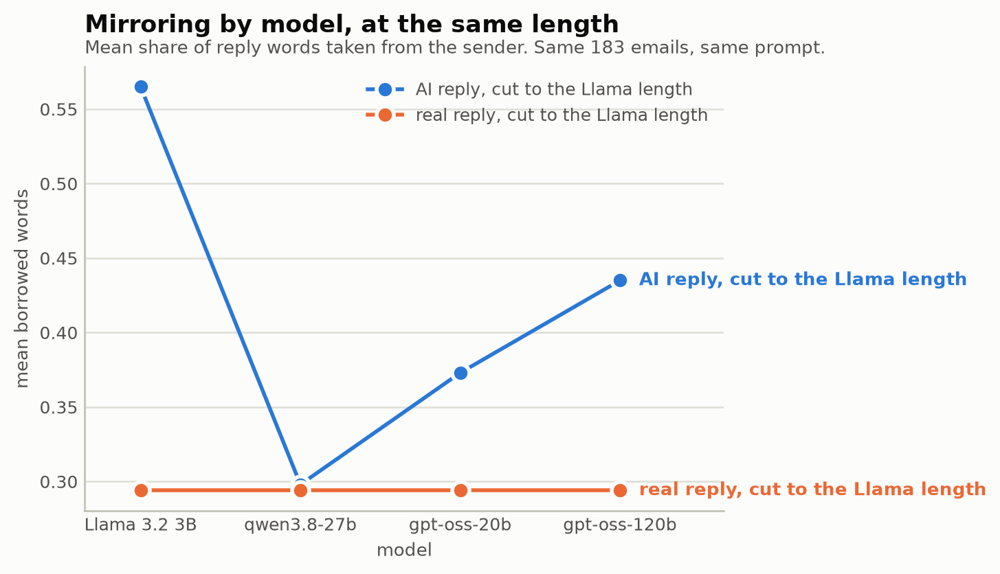

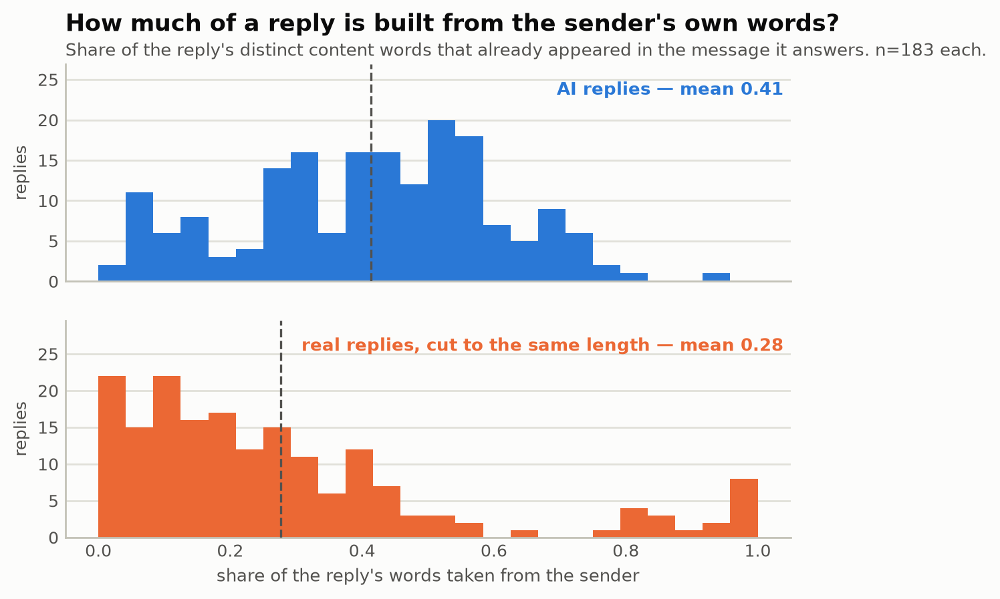

**Paired tests, each free-tier model against Llama at the same length.**

| Model | Score change | p-value | Newly flagged | No longer flagged | p-value (flag test) |
|---|---:|---:|---:|---:|---:|
| DeepSeek V4 Flash | -0.095 | < 0.0001 | 12 | 32 | 0.004 |
| gpt-oss-20b | -0.191 | < 0.0001 | 7 | 33 | < 0.0001 |
| gpt-oss-120b | -0.129 | < 0.0001 | 3 | 30 | < 0.0001 |
| qwen3.8-27b | -0.268 | < 0.0001 | 3 | 35 | < 0.0001 |

The score test (Wilcoxon signed-rank) asks whether the borrowed-words scores
moved. The flag test (McNemar) counts only the replies whose flagged status
changed. All three free-tier models mirror significantly less than Llama.
Size did not help within the OpenAI family: gpt-oss-120b borrows more of the
sender's words than gpt-oss-20b, 0.435 against 0.373, though it is flagged
slightly less often.

**What this means.** Mirroring looks mainly like a weakness of the small
local model, not something all LLMs do. All four models still borrow more
than real writers, 0.294, so none of them fully matches human behavior.

**qwen3.8-27b (added Oct 25).** 182 of 183 replies were valid. qwen
mirrors the least of the five models. At the same length it borrows
0.298 of its words from the sender, almost the same as real replies
(0.294). At full length no qwen reply is flagged. Manifest:
`outputs/manifests/mirroring_qwen.json`.

**Caveats.**

- The 0.80 cutoff and the AUC check behind it come from 100 Llama replies
  coded by Claude, not by a person. No person has coded any reply yet.
  Claude read the 5 highest-scoring DeepSeek replies by hand; none of them
  actually hands the request back, which suggests a high score may mean
  "stays on topic" rather than "mirrors" for the larger models. This needs a
  person's judgment to settle.
- The measure and its cutoff were built and validated on Llama only.
  Applying the same cutoff to a different model's writing style is an
  assumption, not something separately checked.

---

## 8. Can a generated reply be told apart from a real one (Q2)

**How it is measured.**

- **Length-only classifier**: sees only each reply's word count.
- **Text classifier**: sees which words a reply uses (TF-IDF features with
  logistic regression), cross-validated over 5 rounds.
- **Same length**: each real reply is cut to the length of its AI partner
  before the text classifier runs, so whatever separation remains cannot be
  explained by length.
- Before comparing, signature and address lines were removed from real
  replies (routing addresses, company names, street addresses, phone lines,
  and lines that are mostly email addresses). This changed the numbers only
  a little; it did not change any conclusion.

**Combined AUC table**, all rows measured with the same prompt (the
with-instruction Llama grid).

| Model | Length only | Full text | Text, same length |
|---|---:|---:|---:|
| Llama 3.2 3B | 0.837 | 0.919 | 0.881 |
| DeepSeek V4 Flash | 0.571 | 0.978 | 0.977 |
| gpt-oss-20b | 0.687 | 0.974 | 0.970 |
| gpt-oss-120b | 0.748 | 0.969 | 0.962 |
| qwen3.8-27b | 0.473 | 0.983 | 0.982 |

For reference, the earlier, no-instruction Llama grid gave 0.879 (length
only), 0.903 (full text), 0.841 (same length).

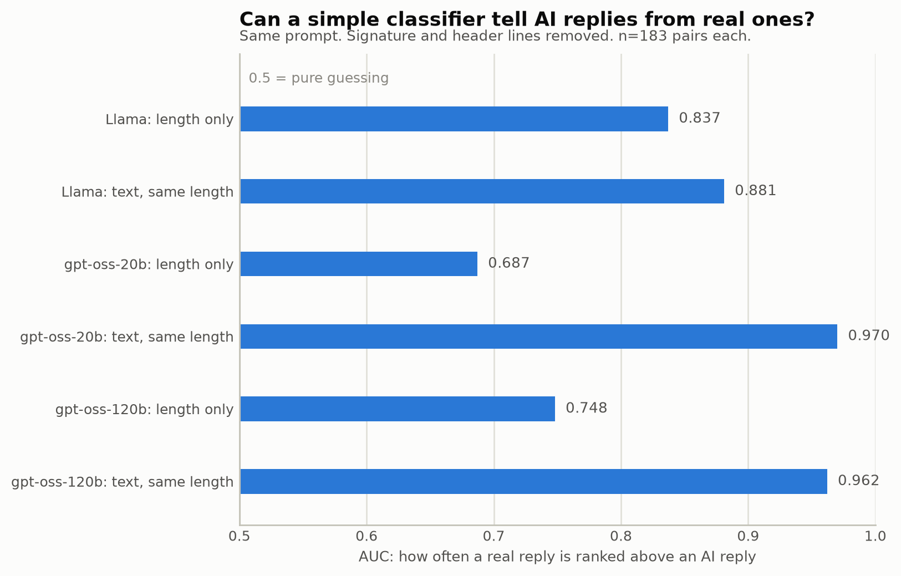

- **Length alone barely gives DeepSeek away** (0.571), a little more for
  gpt-oss-20b (0.687), and more again for gpt-oss-120b (0.748), because its
  replies are the shortest of the three at a 27-word median.
- **Length still gives Llama away** (0.837), because its replies are much
  shorter than real ones.
- **Every free-tier model is still easy to spot by its words**, at 0.96 to
  0.98 even at the same length. Being bigger did not make gpt-oss-120b
  harder to tell from a real person than gpt-oss-20b.
- **qwen3.8-27b (added Oct 25): length does not give it away at all**
  (0.473, about chance). Its replies are 48 words on average, close to
  real ones. **But its words give it away the most of all five models**
  (0.982 at the same length).
- The one-off script behind this table was never saved. The qwen row
  comes from a rebuild of it, made from its description in
  `PROGRESS_nvidia.md`. On the other four models the rebuild matches the
  logged text AUCs within 0.002 and the length-only AUCs within 0.009.
  The rebuild is now 
  (). Manifest:
  . qwen is not in the word table below.

**Which words give each model away.** Share of replies containing the word,
model against real replies (real percentages vary slightly by row, because
real replies are cut to each model's own length for that comparison). "n/a"
means the word was not among the top words reported for that model.

| Word | Real | Llama | DeepSeek | gpt-oss-20b | gpt-oss-120b |
|---|---:|---:|---:|---:|---:|
| "I'll" | 5 to 6% | 29% | 74% | 59% | 61% |
| "let" | 9 to 10% | n/a | 45% | 53% | 38% |
| "know" | 12 to 13% | n/a | 42% | 50% | n/a |
| "review" | 2 to 3% | n/a | 29% | n/a | 23% |
| "confirm" | 0 to 1% | n/a | 19% | 13% | n/a |
| "got" | 1 to 2% | n/a | 11% | 18% | 22% |
| "team" | 0% | n/a | n/a | 14% | 12% |
| "forward" | 3% | n/a | n/a | n/a | 19% |

These come from stock phrases such as "I'll review...", "Let me know..." and
"I'll flag...". Real replies are instead marked by sign-off names and words
like "attached", "department" and "office". Real people sign with their own
name and mention attachments; the models rarely do.

**What this means.** For Llama, "real and AI replies are separable, mostly
by length" was true. For all three free-tier models, it is not: they write
closer to a realistic length, and are still easy to spot by word choice.
Model size (20B against 120B) moved neither the mirroring result nor this
one.

**This disagrees with section 17's rubric scores, and that disagreement is
itself worth noting.** Llama, gpt-oss-20b and gpt-oss-120b -- three of the
four models in the table above -- are flagged instantly by this
word-choice classifier (0.92-0.97 AUC, full text) but score 4.0-4.9 out of
5 on `corpus_plausibility` and `contextual_fit` when an LLM judge reads the
same kind of reply (section 17). Two measures of "does this look real,"
same models, same underlying question, opposite readings. Either the LLM judge
is not sensitive to the specific stock-phrase tells this classifier catches
("I'll review...", "Let me know..."), or "reads as plausible" and "is
statistically indistinguishable from real" are genuinely different
properties -- a model can have one without the other. Not resolved here;
flagged so the two results are not read as redundant confirmations of each
other.

**Caveats.**

- The line-removal rule that cleans signature and header lines is a one-off
  script. The corpus cleaner in `thesis.data.rfc822` does not use it yet.
- One number is unexplained: the full-text AUC for Llama without the
  instruction is 0.903 by this method, while `PROGRESS.md` reports 0.927
  by an earlier one. The length-only numbers match, so the method is
  probably the same; the gap is unresolved.

---

## 9. Do generated replies look like real email in meaning-space? (Q2, Oct 5)

**Finding.** Bigger free-tier models do not look more like real email than
the small local model does. If anything, they look less like it.

**How.** Each reply is embedded with a free local model (`nomic-embed-text`).
A classifier tries to tell real and generated replies apart using only the
embeddings, not the words (AUC: 0.5 = can't tell them apart, 1.0 = always
can). This had only been run on Llama before. This session added the three
free-tier models, reusing pairs files that already existed, so no new
generation was needed.

**Results**, 183 pairs per model.

| Model | AUC, full length | AUC, same length | Tracks its own email |
|---|---:|---:|---:|
| Llama 3.2 3B | 0.890 | 0.817 | 0.863 |
| DeepSeek V4 Flash | 0.911 | 0.907 | 0.858 |
| gpt-oss-20b | 0.932 | 0.924 | 0.814 |
| gpt-oss-120b | 0.904 | 0.909 | 0.825 |
| qwen3.8-27b | 0.934 | 0.936 | 0.819 |

"Same length" cuts each real reply to its AI partner's word count first.
"Tracks its own email" is how often a generated reply sits closer to the
real reply it answered than to an unrelated real reply -- a check against
generic, context-blind writing.

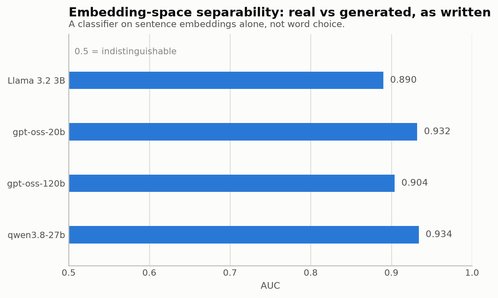
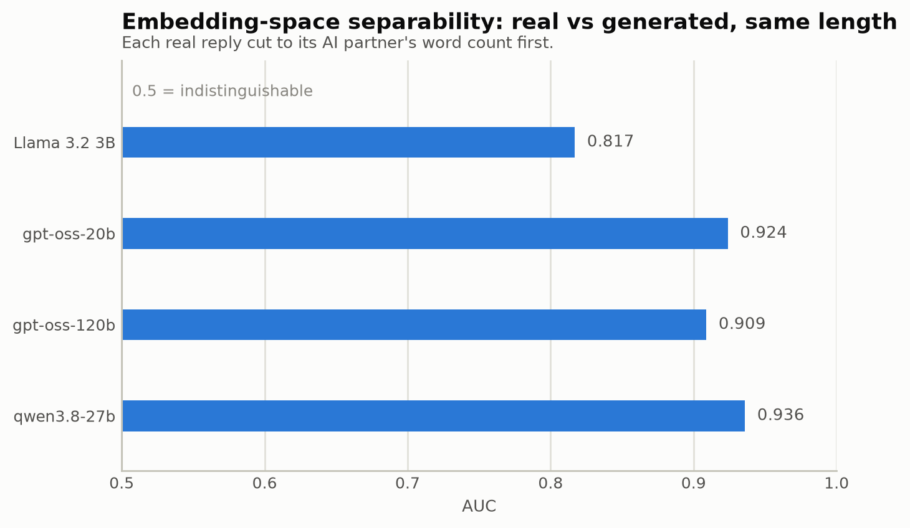

**What this means.**

- **Being bigger did not make a model harder to tell from real email.**
  Llama's AUC (0.890) is the lowest of the four. The word-choice check
  above found the same thing (0.96 to 0.98 AUC for the free-tier models,
  against Llama's 0.919).
- **For Llama, length explains most of the gap. For the free-tier models
  it explains almost none.** Llama's AUC drops from 0.890 to 0.817 once
  both sides are cut to the same length. The three free-tier models barely
  move. So something other than length -- the word-choice check points at
  stock phrases -- is what gives the free-tier models away.
- **All four models stay reasonably tied to the email they are
  answering**, 0.81 to 0.86, with no clear ranking between them.

**Caveats.** Point estimates on 183 pairs per model, no significance test
between models. `nomic-embed-text` is a fixed free choice; a different
embedding model could move the exact numbers, probably not the direction,
since the word-choice check agrees by a completely different method.

Source: `python -m thesis.analysis.embedding_map --pairs
data/interim/pairs_<model>.parquet`, run once per model. Manifests:
`outputs/manifests/embedding_map_{act,deepseek,gpt_oss,gpt_oss_120b,qwen}.json`.
qwen (added Oct 25, 182 pairs) fits the free-tier pattern: easy to tell
apart, and length explains none of it.

---

## 10. Does hierarchy change how directive a reply is (Q1)

Q1 asks whether a persona's place in the hierarchy changes how directive its
replies are, that is, whether it gives more orders when writing down to a
junior person than when writing to a peer or up to someone senior. Every
Llama-only test before this found no clear effect (`PROGRESS.md` sections 33
to 39), with one borderline exception. The open question is whether a larger
model shows a pattern the small one does not. DeepSeek and gpt-oss-120b show
it. gpt-oss-20b does not. Whether any of them shows it more strongly than
real email does is a separate question, answered below, and the answer is no
for all three once the numbers are checked properly.

**How it is measured.** The Q1 grid is 10 personas times 3 directions times
4 incoming tones times 2 task types, one reply each, 240 replies total. This
is the design fixed in `PROGRESS.md` section 39.

- **Reply level**: the share of a reply's sentences that are imperative,
  compared across directions with a linear mixed model that allows for each
  persona's own habits.
- **Sentence level**: each sentence counts once, as an order or not,
  compared with a logistic mixed model. Its coefficients are also turned
  into the probability that a sentence is an order.
- Every coefficient below is the difference from writing to a peer. Positive
  means more imperative.

**Results**, all five grids using the same measurement code.

| Grid | Reply level, down | Reply level, up | Sentence level, down | Sentence level, up |
|---|---:|---:|---:|---:|
| Llama, no instruction (original pilot) | +0.027 (p=.672) | +0.083 (p=.192) | +0.163 (p=.401) | +0.395 (p=.046) |
| Llama, with instruction | +0.056 (p=.412) | +0.029 (p=.670) | +0.197 (p=.298) | +0.151 (p=.437) |
| DeepSeek V4 Flash | +0.099 (p=.003) | +0.015 (p=.647) | +0.438 (p<.001) | +0.059 (p=.654) |
| gpt-oss-20b | +0.036 (p=.348) | +0.023 (p=.537) | +0.136 (p=.296) | +0.085 (p=.537) |
| gpt-oss-120b | +0.195 (p=.001) | +0.052 (p=.361) | +0.896 (p≈.001)* | +0.297 (p=.088) |

\* The sentence-level p-value the code prints for gpt-oss-120b is p=5e-08.
That number is too small and should not be quoted. It comes from a
variational-Bayes fit whose posterior standard deviation understates
uncertainty. A persona-clustered standard error and a persona bootstrap both
put it at p≈.001. The coefficient itself, +0.896, is stable across five
different ways of computing it (plain logistic, clustered by reply, clustered
by persona, a permutation test, a persona bootstrap), all landing between
+0.90 and +0.93. Only the p-value the code reports is wrong, not the effect.

This was a one-off manual check. The code now computes the persona-clustered
cross-check itself (`Q1Result.sentence_model_persona_fe`, commit `85e833a`),
so a rerun would report it without another manual pass. The table above
still shows this manual check for gpt-oss-120b only; the other three rows
have not been rechecked against the clustered fit yet.

Probability that a sentence is an order, from the sentence-level model. The
gpt-oss-20b and gpt-oss-120b rows are the plain share of sentences that are
orders. The design is balanced across directions, so this agrees closely with
the model's fitted probability (for DeepSeek they differ by 0.2 points).

| Grid | Writing down | Writing to a peer | Writing up |
|---|---:|---:|---:|
| Llama, no instruction | 31.7% | 28.3% | 36.9% |
| Llama, with instruction | 40.7% | 36.0% | 39.6% |
| DeepSeek V4 Flash | 33.5% | 24.5% | 25.6% |
| gpt-oss-20b | 41.0% | 37.8% | 39.8% |
| gpt-oss-120b | 43.0% | 23.2% | 29.6% |

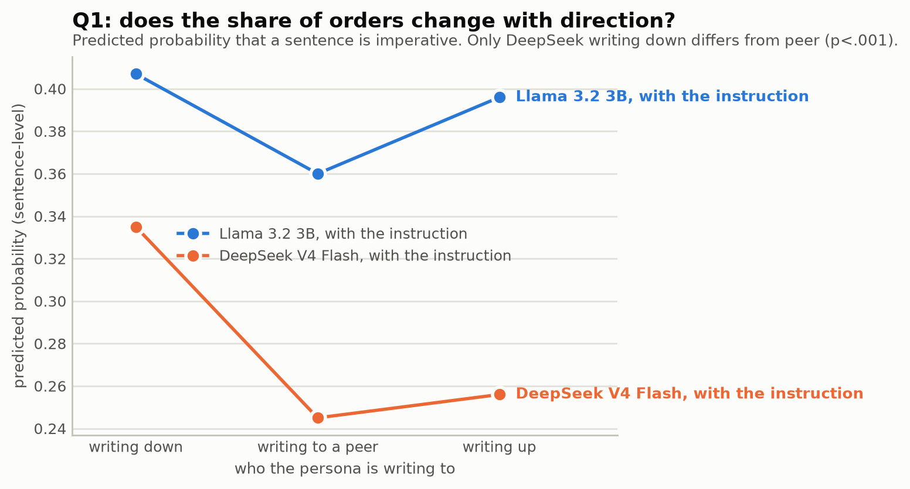

- **DeepSeek gives more orders when writing down.** Both measures agree, and
  both stay significant after a Bonferroni correction for four tests
  (needs p < 0.0125): 0.003 and 0.0004.
- **DeepSeek's writing up looks like writing to a peer.** Both contrasts are
  far from significant.
- **Llama shows no reliable effect in either direction**, with either prompt.
- **The one borderline Llama result did not hold.** With the act
  instruction, its "up" contrast fell from p=.046 to p=.437, which reads as
  noise rather than a real effect.
- **DeepSeek's replies carry more sentences**: 882 across the grid against
  343 for Llama with the same prompt, 3.71 sentences per reply against 1.43.
  `PROGRESS.md` section 34 warned that one-sentence replies make the
  reply-level measure crude. DeepSeek has none, so its estimate rests on
  more data. gpt-oss-20b also writes several sentences per reply: 719
  across the grid, 3.02 per reply.
- **gpt-oss-20b shows no writing-down effect.** Orders per sentence, down:
  +0.136 (p=.296). Orders per reply, down: +0.036 (p=.348). Writing up shows
  nothing either (+0.085, p=.537). This looks like Llama and not like
  DeepSeek.
- **gpt-oss-20b gives orders in about 40% of its sentences in every
  direction.** Real email does it in 14% to 18%. The level is far too high,
  and it barely moves with direction (41.0%, 37.8%, 39.8%).
- **Two side results.** The decision depends on direction for both DeepSeek
  and Llama (Llama p=.023, DeepSeek p=.002), but not for gpt-oss-20b
  (p=.308). This plain chi-square test ignores that replies from one persona
  are alike, so it is only a hint. Hedging falls for Llama and DeepSeek when
  writing down. gpt-oss-20b almost never hedges (0.000 writing down, 0.003
  to a peer, 0.000 writing up), so it has nothing to fall. DeepSeek also
  almost never hedges (at most 0.014 in any direction, against 0.08 to 0.19
  for Llama).
- **gpt-oss-120b is the only model of the four that clearly shows the
  writing-down effect.** Orders per sentence, down: +0.896 (p≈.001, corrected
  as above). Orders per reply, down: +0.195 (p=.001). Writing up shows
  nothing (+0.297, p=.088).
- **The reply-level persona term collapses for gpt-oss-120b**, the same way
  it does for the other three grids: the model reports a persona variance of
  0.0008, which is a fit sitting at the edge of its range rather than a real
  estimate of zero. This does not threaten the contrast, because every
  persona answers all three directions, so persona cannot confound direction.
- **gpt-oss-120b's replies are short: 1.98 sentences each**, the fewest of
  the four models (Llama 1.43, gpt-oss-20b 3.02, DeepSeek 3.71). The effect
  holds inside every reply-length group checked (1-sentence, 2-sentence,
  3-sentence replies all show more orders when writing down), so the short
  replies do not manufacture the within-model effect. They do matter for the
  comparison against real email, below.
- **The decision gpt-oss-120b gives also changes with direction**, more so
  than for any other model (chi2=24.95, p=.002). Writing down brings more
  "decline" (21 of 80, against 10 to a peer) and much less "defer" (22
  against 36 to a peer). "Escalate" appears only when writing up (6 replies,
  zero in the other two directions). gpt-oss-120b also answers "none" far
  more often than the other models: 24% of its replies, against 12% for
  gpt-oss-20b and about 1% for Llama. The decision field is not fully
  reliable on its own (section 50: 67.7% agreement between two draws), so
  read this as a pattern worth watching, not a settled result.

**Against the real-email benchmark.** `PROGRESS.md` section 48 measured the
same three things in 2,202 real Enron emails, and compared them only with
the Llama grid. This log adds the DeepSeek and gpt-oss-20b sides of that
comparison, using a rough z-test on the difference (rough because both
sides' standard errors are backed out of a coefficient and a p-value).

| Contrast | DeepSeek | Real email | Difference | p |
|---|---:|---:|---:|---:|
| Orders per email, down | +0.098 (p=.003) | +0.043 (p=.002) | +0.056 | .125 |
| Orders per email, up | +0.016 (p=.640) | +0.018 (p=.133) | -0.002 | .955 |
| Orders per sentence, down | +0.439 (p<.001) | +0.253 (p<.001) | +0.185 | .169 |
| Orders per sentence, up | +0.059 (p=.654) | +0.070 (p=.096) | -0.011 | .936 |
| Hedges per email, down | -0.013 (p=.040) | -0.005 (p=.526) | -0.009 | .362 |
| Hedges per email, up | -0.007 (p=.274) | -0.005 (p=.429) | -0.002 | .809 |

The same comparison for gpt-oss-20b:

| Contrast | gpt-oss-20b | Real email | Difference | p |
|---|---:|---:|---:|---:|
| Orders per email, down | +0.036 (p=.348) | +0.043 (p=.002) | -0.007 | .859 |
| Orders per email, up | +0.023 (p=.537) | +0.018 (p=.133) | +0.006 | .884 |
| Orders per sentence, down | +0.136 (p=.296) | +0.253 (p<.001) | -0.118 | .401 |
| Orders per sentence, up | +0.085 (p=.537) | +0.070 (p=.096) | +0.014 | .921 |
| Hedges per email, down | -0.003 (p=.218) | -0.005 (p=.526) | +0.001 | .852 |
| Hedges per email, up | -0.003 (p=.220) | -0.005 (p=.429) | +0.002 | .788 |

The same comparison for gpt-oss-120b, first with the code's own p-values and
then read plainly below the table.

| Contrast | gpt-oss-120b | Real email | Difference | p |
|---|---:|---:|---:|---:|
| Orders per email, down | +0.195 (p=.001) | +0.043 (p=.002) | +0.152 | .009 |
| Orders per email, up | +0.052 (p=.361) | +0.018 (p=.133) | +0.034 | .554 |
| Orders per sentence, down | +0.896 (p≈.001) | +0.253 (p<.001) | +0.643 | .000\* |
| Orders per sentence, up | +0.297 (p=.088) | +0.070 (p=.096) | +0.226 | .206 |
| Hedges per email, down | -0.004 (p=.221) | -0.005 (p=.526) | +0.000 | .957 |
| Hedges per email, up | -0.004 (p=.221) | -0.005 (p=.429) | +0.001 | .908 |

\* Do not read this as gpt-oss-120b showing a significantly bigger effect
than real email. The difference-of-p column here uses the code's flawed
sentence-level standard error, the same one flagged above. With a
persona-clustered standard error the difference is p≈.03, and that does not
survive a Holm correction across the six contrasts in this table (adjusted
p≈.16), let alone across all four models' contrasts together. The honest
statement is that gpt-oss-120b's point estimate is larger than real email's,
and that this gap is not established as more than chance.

There is a second, separate reason not to trust the size of that gap.
gpt-oss-120b writes 1.98 sentences per reply; real email averages 4.75
sentences per message (`outputs/manifests/q1_real.json`). Orders per sentence
is a share over a reply's sentences, so a short reply produces a more
extreme share for the same underlying behavior. This is the same length
problem `borrowed_words` has (see the mirroring section above), showing up in
a different measure. No length-matched version of this comparison exists
yet. Until one does, the +0.643 gap against real email is not verified,
whatever its p-value says.

| Chance a sentence is an order | Writing down | To a peer | Writing up |
|---|---:|---:|---:|
| Real email | 17.5% | 14.2% | 15.0% |
| DeepSeek | 33.5% | 24.5% | 25.6% |
| gpt-oss-20b | 41.0% | 37.8% | 39.8% |
| gpt-oss-120b | 43.0% | 23.2% | 29.6% |

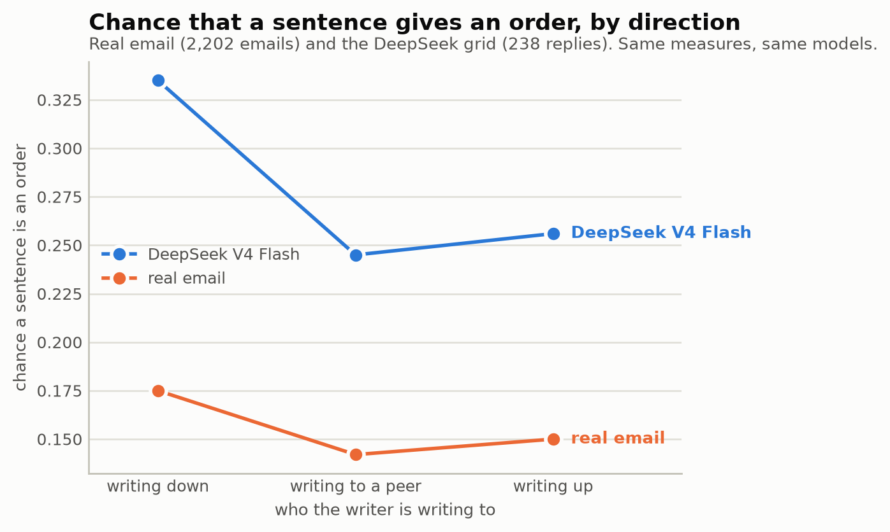

- **DeepSeek gets the shape right.** Writing down is highest on both lines,
  and writing up sits close to writing to a peer on both.
- **DeepSeek's swing is bigger, but not provably so.** Down minus peer is
  +9.0 points in DeepSeek against +3.3 points in real email. No contrast
  between DeepSeek and real email is significant.
- **Llama and gpt-oss-20b sit near the real effect size but detect
  nothing.** Llama's down effect is +0.198 (p=.298) and gpt-oss-20b's is
  +0.136 (p=.296), against the real +0.253. Neither is different from real
  email. Neither is different from zero.
- **Sentence count does not explain the split.** The first version of this
  section said DeepSeek finds the effect because its replies carry far more
  sentences. gpt-oss-20b writes 719 sentences against DeepSeek's 882, and
  finds nothing. Llama's 343 are fewer, but 20b shows that plenty of
  sentences is not enough. gpt-oss-120b confirms this the other way: it
  writes the fewest sentences of the four (474) and shows the clearest
  effect of the four.
- **DeepSeek and gpt-oss-20b are not provably different.** Their writing-down
  effects differ by 0.303 (p=.092). So this section cannot say that 20b
  lacks the effect and DeepSeek has it. It can say that 20b's data are also
  consistent with the real effect.
- **gpt-oss-120b gets the shape right and overshoots it.** Writing down is
  highest, writing up sits above writing to a peer, both as in real email.
  The down-versus-peer swing is +19.5 points against real email's +3.3, and
  unlike DeepSeek's swing this one is a real effect on its own (p≈.001). Read
  the last two paragraphs above before treating the size of the overshoot as
  established: the standard comparison test does not survive correction, and
  gpt-oss-120b's short replies inflate the per-sentence share regardless.

**All the models side by side.** The effect is the difference in the log-odds
that a sentence gives an order, writing down against writing to a peer. Real
email's +0.253 moves the chance from 14.2% to 17.5%, so a bigger number means
a bigger jump. Each line is a 95% interval. An interval that crosses zero
means the grid cannot show the effect. This figure and its intervals are
regenerated with the persona-clustered fit (commit `85e833a`), not the
variational-Bayes fit the "vs real email" tables above still use, so
numbers here differ slightly from the "orders per sentence" rows in those
tables -- same effect, two different standard errors.

| | coefficient | p | 95% interval |
|---|---:|---:|---:|
| Real email | +0.253 | <.001 | [+0.15, +0.35] |
| DeepSeek V4 Flash | +0.464 | .001 | [+0.19, +0.73] |
| gpt-oss-120b | +0.921 | .002 | [+0.35, +1.50] |
| Llama 3.2 3B | +0.207 | .515 | [-0.42, +0.83] |
| gpt-oss-20b | +0.155 | .239 | [-0.10, +0.41] |

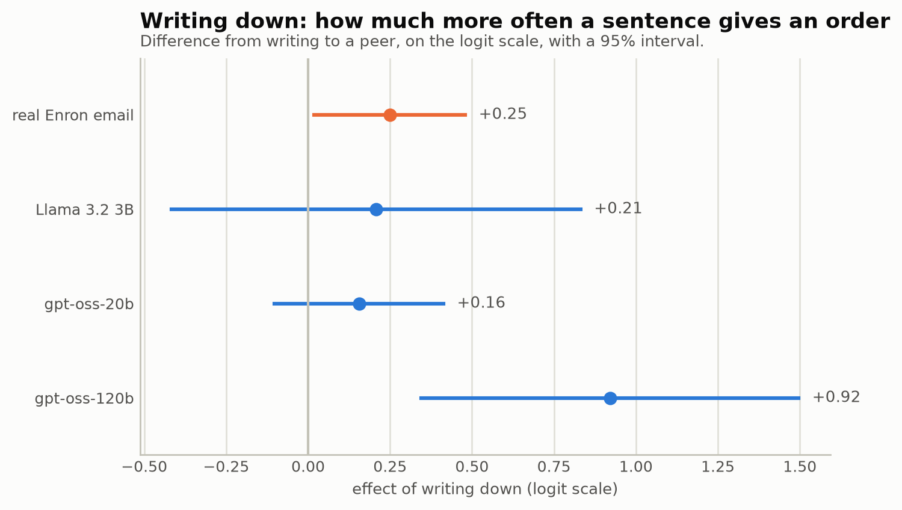

- **DeepSeek's and gpt-oss-120b's intervals stay clear of zero.** DeepSeek
  runs from +0.19 to +0.73 and also contains the real +0.25. gpt-oss-120b
  runs from +0.35 to +1.50 and also contains the real +0.25, but only just
  at the bottom of its own interval, which is the top of real email's own
  interval.
- **Llama's and gpt-oss-20b's intervals cross zero.** The grids are too
  small to say either model shows an effect at all, let alone whether it
  differs from real email.
- **gpt-oss-20b's interval runs from -0.10 to +0.41.** It has about as many
  sentences as DeepSeek and an interval of nearly the same width (0.52
  against 0.54). It sits lower, and it crosses zero.

**Caveats.**

- One reply per cell, 10 personas. In the reply-level model the persona
  variance is 0 for both grids, so the model works like a plain regression;
  the fit warns it sits at the edge of its range.
- The "vs real email" tables above still use the variational-Bayes
  sentence-level p-value, which is approximate (a Wald test from that fit)
  and understates uncertainty on a large effect -- see the gpt-oss-120b
  footnote earlier in this section. The persona-clustered fit table just
  above does not have this problem, but has not been substituted into
  those earlier tables yet.
- The DeepSeek grid has 238 replies, not 240: 2 came back without valid
  JSON, one writing up and one writing down. The gpt-oss-20b grid also has
  238: one lateral and one writing up.
- gpt-oss-20b ran with `@low` reasoning effort, as in every other section of
  this log. The 20b grid took about 2.5 hours, mostly NVIDIA stalls and
  retries.
- Real email and the simulator are not the same kind of sample: 2,202 real
  emails from 107 senders against 238 (or 240) simulator replies from 10
  personas, one reply each. Real email has no decision field, so decisions
  cannot be compared. The z-test is rough for the reason stated above.
- The gpt-oss-120b grid took two days, not because of anything about the
  model: Groq allows 200,000 tokens per day and the grid needs about
  460,000. A loop retried every 30 minutes and resumed from the cache each
  time it hit the cap. 238 of 240 cells were cached from Sep 21; the last 2
  generated on Sep 22.
- **The sentence-level p-value this project's own code reports understates
  uncertainty when an effect is large**, from a variational-Bayes posterior
  standard deviation (`hierarchy.py`). gpt-oss-120b's case (reported p=5e-08,
  honest p≈.001) is what exposed it. Fixed: the code now also fits a
  persona-clustered cross-check on its own (`Q1Result.sentence_model_persona_fe`,
  commit `85e833a`) -- see the "22. Next steps" done-block below for what still
  needs it substituted in.
- **Two small bugs found while checking this result, since fixed.** The Q1
  grid generator now writes `prompt_text_hash()` onto the saved grid instead
  of only computing it in memory (commit `5ee4b46`), and `q1_models.py`'s
  grid loader now counts real cache/generation numbers instead of
  hard-coding every row as "from cache" (commit `36fbc3e`). See "22. Next
  steps" for the one small gap that remains.

---

## 11. The full design: how the 1,440-cell grid differs from the pilot (Q1)

Every Q1 section before this one uses the same small grid: 24 scenarios
(2 task types x 3 directions x 4 tones) x 10 personas, one reply each,
240 replies. This is the pilot design fixed in `PROGRESS.md` section 39.

**The full design is bigger, not different.** It uses all 144 scenarios
(6 task types x 3 directions x 2 stakes x 4 tones) x 10 personas: 1,440
cells. The pilot's 24 scenarios are an exact subset of these 144, so a
full-design run reuses every pilot reply already generated -- nothing
from the pilot is thrown away or regenerated.

**Why run it.** Real email shows the writing-down effect clearly
(+0.253, p<.001, 2,202 emails). The pilot's 240 replies were too few to
show the same effect at a normal significance level, even though the
estimate itself held steady as the pilot was re-run at different sizes.
Reaching 80% power on an effect this size needed about 4,028 replies
(`HANDOVER.md` section 6.2's estimate) -- more than one pass of the full
design (1,440) and more than the pilot by a factor of 17. For Llama, it
took three full-design draws, 4,320 replies, to clear that bar (section
12, directly below).

**Which models have run it, and at what scale.**

| Model | Draws at full scale | Total replies |
|---|---:|---:|
| Llama 3.2 3B | 3 | 4,320 |
| gpt-oss-20b | 1 | 1,428 |
| gpt-oss-120b | 1 | 1,440 |
| qwen3.8-27b | 1 | 1,440 |
| DeepSeek V4 Flash | 0 -- pilot only | 240 |

DeepSeek never ran the full design: NVIDIA retired the model this
project uses (section 18) before one was attempted, so its 240 pilot
replies are fixed in place. qwen3.8-27b takes its place at full scale.

---

## 12. The main Q1 run reaches significance (Q1, Sep 23)

This section covers Llama 3.2 3B's own full-design run (section 11),
generated locally. It is the run `HANDOVER.md` section 6.2 and
`PROGRESS.md` sections 39/51/54 track, and the "14-more-hours" question
`PROGRESS_llms.md`'s Next steps item 2 pointed back to.

**Why this run.** Real email shows the writing-down effect clearly (+0.253,
p<.001, 2,202 emails). Every earlier size of this same local grid failed to
show it at a normal significance level, even though the effect kept getting
more precisely measured as the sample grew:

| Sample | Sentence-level coefficient | p |
|---|---:|---:|
| 240 replies (`PROGRESS.md` section 39) | +0.163 | .401 |
| 1,440 replies (section 51) | +0.134 | .092 |
| 2,880 replies, 2 draws averaged (section 54) | +0.092 | .130 |
| **4,320 replies, 3 draws averaged (tonight)** | **+0.157** (VB) / **+0.127** (persona-clustered) | **.002** (VB) / **.0006** (persona-clustered) |

Reaching 80% power on an effect this size needed about 4,028 replies
(`HANDOVER.md` section 6.2's own estimate). 4,320 clears that.

**What was run.** One command, overnight, in a detached `tmux` session on
this laptop, no API and no cost:

```
python -m thesis.analysis.q1 --local llama3.2:3b --design full --replicates 3 \
  --progress-every 50 --out data/interim/q1_direction_grid_full_3draws.parquet
```

Draws 1 and 2 were already cached from sections 51 and 54 (the prompt has
not changed since), so only the 1,440 replies of draw 3 needed real
generation. That took about 6 hours (22:10 to 04:10), faster than the
roughly 11 hours draw 2 alone took in section 54, because a warm cache
means most of the run is instant.

**The effect is real now, on two different ways of computing its standard
error.** The code's own variational-Bayes fit gives p=.002. A
persona-clustered fixed-effects fit, pooled across all 3 draws, gives
p=.0006. Both say the same thing: this was underpowered before, not absent.

**Correction (Oct 4):** this section first attributed the p=.0006 number to
`Q1Result.sentence_model_persona_fe`. That field is always fit on draw 1
alone, which gives p=.248 on this same grid, not .0006 -- the .0006 was a
by-hand fit of the same method on all 3 draws pooled, a fit the code itself
had no field for at the time. `sentence_model_persona_fe_pooled` now covers
that case (commit `561a2cb`), and `q1_models.py`'s model-comparison report
now uses it instead of silently falling back to the draw-1 fit. Also:
treat .0006 as anti-conservative, not as the headline p-value. It comes
from clustering by only 10 personas, and the per-draw version of this same
fit jumps around a lot (p=.248 on draw 1 alone, p=.018 on draw 3 alone) --
a sign the pooled SE is smaller than it should be. The VB pooled p=.002 is
the safer number to quote; the conclusion ("significant, not absent") does
not change either way.

**It looks smaller than real email's effect, but whether that gap is itself
significant depends on which fit does the comparing -- corrected below,
this was wrong in an earlier version of this section.** Three ways of
comparing against real email's +0.253, each defensible on its own:

| Fit used for the simulator side | Coefficient | Difference | z | p |
|---|---:|---:|---:|---:|
| Draw 1 only, VB | +0.134 | −0.119 | −1.26 | .209 |
| 3 draws pooled, VB (nested by cell) | +0.156 | −0.097 | −1.34 | .182 |
| 3 draws pooled, persona-clustered | +0.127 | −0.126 | −1.98 | .047 |

Only the third crosses .05, and it is the one whose standard error comes
from clustering by persona -- with only 10 personas, cluster-robust standard
errors are known to run anti-conservative (biased toward too small, which
inflates significance). A first version of this section quoted only that
third row, unqualified, and that number had already gone onto a supervisor
slide before this was caught (thanks to a second Claude session checking
this file independently -- see `HANDOVER.md` section 6.2 for its own
write-up of the same finding). The honest statement: the simulator now
clearly shows the writing-down effect (that part is solid, all fits agree),
and it looks smaller than real email's, but whether that gap is
statistically established is not settled -- it depends on the method, and
the method that says yes is the one most likely to be overconfident. Section
54's own p=.043 for the 2-draw grid has not been checked against other
estimators either, so it carries the same unstated caveat.

**The number in the table above and the "Against real email" print were two
different numbers -- a second bug, since fixed.** `grid_contrasts` (which
feeds `compare_with_real`, the CLI's "Against real email" table) and
`contrast_estimates` (which feeds the "Precision" table and the manifest's
`primary`/`precision` sections) both always read `result.sentence_model`,
`result.reply_model` and `result.hedge_model` -- the draw-1-only fits --
regardless of how many draws the grid actually had. For this grid that
meant the printed comparison against real email, and the saved manifest's
own headline number, silently used a third of the data (+0.134, the
1,440-replies row) while this write-up quoted the correctly pooled number
(+0.157/+0.127). Both now prefer the pooled fit
(`sentence_model_clustered`/`aggregated_reply_model`/`aggregated_hedge_model`)
when a grid has more than one draw, falling back to the draw-1-only fit
otherwise, where the two are the same thing anyway. Commit `82cd1ae`.
`outputs/manifests/q1_full_grid_3draws.json`
has been regenerated; its `primary.is_imperative:down` now reads
coefficient=0.1566, p=.0022, matching the pooled VB row in the table above.

**A new bug, found by actually using this code path -- since fixed.**
`draw_stability.grid_draw_reliability`, which `run_q1_analysis` calls
automatically whenever a grid has more than one draw, was hard-coded to
expect exactly draws 1 and 2 and raised `ValueError` on anything else. No
grid had ever been run with 3 draws before that night, so it never got hit.
The crash was only in that one reliability check, not in generation or in
the headline models -- the grid file and the numbers above were never in
doubt.

Fixed (commit `a9ae1d2`) by generalizing each of the three statistics to
however many draws a grid has, by the standard multi-rater form of each
rather than by picking one pair or averaging pairs: the ICC calculation was
already written generically in terms of raters and needed no new formula;
the correlations become the mean over every pair when there is more than
one pair; and decision agreement switches from Cohen's kappa to Fleiss'
kappa (the textbook generalization past two raters), while staying byte-for-
byte the same Cohen's kappa computation at exactly two draws, so every
already-published two-draw kappa is unaffected. `run_q1_analysis` now
completes on the 3-draw grid without a workaround, and running it produced
the first official manifest and figure for this grid,
`outputs/manifests/q1_full_grid_3draws.json` and
`docs/figures/q1_full_grid_vs_real_3draws.png` -- the `is_imperative_clustered`
entry there (+0.1566, p=.002053) matches the by-hand VB number reported
above to four digits, now computed by the ordinary code path instead of a
one-off script.

The grid's own draw-to-draw reliability, now measurable across all three
draws at once: orders per reply, ICC=0.351 (two draws predicted 0.52, three
predicted 0.62 -- the prediction says draws should agree more than they
actually do, a question for later, not answered here); hedges per reply,
ICC=0.260; decision, 55.5% of cells have all three draws agree exactly,
Fleiss' kappa=0.367.

---

## 13. Q1 across models, at full design scale (Q1, Oct 4)

The "10. Does hierarchy change how directive a reply is" section above
compared four models on the pilot grid (section 11 explains the full
design used from here on). gpt-oss-20b, gpt-oss-120b and qwen3.8-27b
each finished one full-design draw; Llama's own full-design run is
section 12, directly above. This section puts all four side by side at full scale,
measured the same way the pilot ones were: reply level (share of a
reply's sentences that are imperative, a linear mixed model) and sentence
level (each sentence an order or not, a logistic model), each compared
across directions against writing to a peer.

**Headline.** The same persona-clustered fixed-effects cross-check the
pilot section used for gpt-oss-120b, now computed correctly for a
multi-draw grid too (see the correction above the Sep-23 entry):

| Model | Replies | Sentences | Writing-down effect | p | 95% interval | vs real email, p |
|---|---:|---:|---:|---:|---|---:|
| Real email | 2,202 | | +0.253 | <.001 | [+0.15, +0.35] | |
| Llama 3.2 3B (3 draws) | 4,320 | 6,117 | +0.127 | .001 | [+0.05, +0.20] | .183 |
| gpt-oss-20b | 1,428 | 3,886 | +0.258 | <.001 | [+0.18, +0.34] | .984 |
| gpt-oss-120b | 1,440 | 2,571 | +0.483 | <.001 | [+0.35, +0.61] | .009 |
| qwen3.8-27b | 1,440 | 5,568 | +0.510 | <.001 | [+0.44, +0.58] | <.001 |

Command: `python -m thesis.analysis.q1_models --grid "..." --figure-prefix
q1_models_full_ --manifest outputs/manifests/q1_models_full.json`, reading
each model's already-generated grid file, no API call. Manifest:
`outputs/manifests/q1_models_full.json`. Figure:
`docs/figures/q1_models_full_writing_down.png`. qwen3.8-27b's decision,
hedging and persona-variance numbers below come from its own grid
manifest, `outputs/manifests/q1_full_grid_qwen_qwen3.8-27b.json`.

**The same measure, for writing up.** `direction` is a three-level factor
(down, lateral, up); the persona-clustered fit above already estimates both
non-reference contrasts at once, it just was not pulled out for "up" until
now. Same grids, same fit, the other coefficient:

| Model | Writing-up effect | p | 95% interval | vs real email, p |
|---|---:|---:|---|---:|
| Real email | +0.072 | .404 | [-0.10, +0.24] | |
| Llama 3.2 3B (3 draws) | -0.009 | .820 | [-0.09, +0.07] | .142 |
| gpt-oss-20b | +0.005 | .951 | [-0.14, +0.15] | .356 |
| gpt-oss-120b | +0.106 | .046 | [+0.00, +0.21] | .704 |
| qwen3.8-27b | -0.181 | .001 | [-0.29, -0.07] | <.001 |

Replies and sentences per model are the same as the writing-down table
above (same grid, same fit, the other contrast).

**What this means.**

- **The expected pattern is more orders writing down and fewer writing
  up.** qwen3.8-27b is the only model that shows both halves, and it
  shows them most strongly (+0.510 down, -0.181 up, both significant).
  Llama and gpt-oss-20b show only the first half. gpt-oss-120b shows the
  first half, and its writing-up effect goes the other way (+0.106).
  Real email itself shows only the first half, so qwen overstates the
  pattern rather than matching real email.
- **Real email itself shows no writing-up effect** (p=.404). Hierarchy's
  effect on directiveness in this corpus is asymmetric: strong going down,
  essentially absent going up.
- **Two models show a significant writing-up effect by this fit, in
  opposite directions.** gpt-oss-120b gives more orders when writing up
  (+0.106, p=.046). qwen3.8-27b gives fewer (-0.181, p=.001). Llama and
  gpt-oss-20b show none (p=.820, p=.951), matching real email.
- **gpt-oss-120b's effect is not significantly different from real email's
  own non-effect** (p=.704) -- the same "sits inside real email's own
  uncertainty" read the closing bullet above gives every other contrast.
  Being significant on its own and being different from real email are two
  different questions; this clears the first but not the second.
- **qwen3.8-27b's writing-up effect does differ from real email**
  (p<.001). It is the only model that clears both questions.
- **This disagrees with the VB-based fit further down** ("Both measures,
  both directions"): that fit gives gpt-oss-120b's writing-up coefficient
  as +0.103, p=.160 (not significant); this persona-clustered fit gives
  +0.106, p=.046 (significant) -- nearly the same coefficient, a very
  different p-value. This looks like the same VB-understates-uncertainty
  problem this project already found and fixed for the down contrast
  (sections 12/15), showing up again here on the up side, for this one
  model -- not yet checked with the same robust-SE tooling those sections
  built for down.

Source: re-fit directly from the same four grids
(`data/interim/q1_direction_grid_full_3draws.parquet`,
`..._gpt_oss_20b_full.parquet`, `..._gpt_oss_120b_full.parquet`,
`..._qwen_full.parquet`),
`persona_fe.contrast("up")` instead of `"down"` on the same fitted object
the headline table already built. No new API calls, no new model fit.

**Both measures, both directions**, using each grid's own code-path fit
(the pooled clustered fit for Llama's 3 draws, the same thing as draw 1 for
the other single-draw grids -- this is the variational-Bayes-based fit,
not the persona-clustered one in the headline table above):

| Grid | Reply level, down | Reply level, up | Sentence level, down | Sentence level, up |
|---|---:|---:|---:|---:|
| Llama 3.2 3B (3 draws) | +0.021 (p=.294) | -0.011 (p=.596) | +0.157 (p=.002) | -0.029 (p=.584) |
| gpt-oss-20b | +0.059 (p=.002) | +0.003 (p=.893) | +0.255 (p<.001) | +0.003 (p=.953) |
| gpt-oss-120b | +0.102 (p<.001) | +0.014 (p=.499) | +0.481 (p<.001) | +0.103 (p=.160) |
| qwen3.8-27b | +0.123 (p<.001) | -0.049 (p=.001) | +0.510 (p<.001) | -0.182 (p<.001) |

Chance that a sentence gives an order, by direction:

| Grid | Writing down | To a peer | Writing up |
|---|---:|---:|---:|
| Real email | 17.5% | 14.2% | 15.0% |
| Llama 3.2 3B (3 draws) | 34.9% | 32.1% | 31.9% |
| gpt-oss-20b | 42.0% | 36.0% | 36.1% |
| gpt-oss-120b | 41.1% | 30.1% | 32.3% |
| qwen3.8-27b | 52.0% | 39.4% | 35.2% |

- **gpt-oss-20b did not show the effect at pilot scale (240 replies,
  +0.136, p=.296) but shows it clearly at full scale (1,428 replies,
  +0.255, p<.001).** This was underpowered before, the same story as
  Llama's own pilot-to-full jump (Sep 23, above). Writing up shows nothing
  at full scale either (+0.003, p=.953).
- **gpt-oss-20b's sentence-level effect size is close to real email's:
  +0.255 against +0.253.** Not significantly different (p=.984, headline
  table). Read as "no evidence of a difference", not as proof the two are
  the same -- that needs equivalence testing, not a plain z-test, and the
  z-test itself backs both sides' standard errors out of a coefficient and
  a p-value rather than comparing them directly.
- **gpt-oss-120b still shows the effect at full scale, but the overshoot
  shrank by about half.** Pilot sentence-level coefficient was +0.896
  (honest corrected value ≈+0.92, see the pilot section's own footnote);
  full-design is +0.481, still clearly bigger than real email's +0.253 but
  much closer to it than the pilot run suggested. The gap against real
  email is significant using real email's main fit (p=.009) but drops to
  p=.084 using real email's other fit (`q1_real.py`'s sender-fixed-effects
  cross-check, which has a wider standard error). Read this as not settled,
  not as a confirmed difference -- see "14. Length-matching the Q1-vs-real
  comparison" below for two more reasons this gap does not hold up: cutting
  real email to the same reply length, and a robust standard-error check
  that puts this very p=.009 in doubt too.
- **gpt-oss-120b's replies are still short: 1.79 sentences each at full
  scale** (1.98 at pilot scale, 4.75 for real email). A short reply
  inflates the "orders per sentence" share for the same underlying
  behavior -- the same caveat the pilot section raised. No length-matched
  version of this comparison exists yet (see "22. Next steps").
- **qwen3.8-27b shows the biggest writing-down effect of the four:
  +0.510, about twice real email's +0.253.** Its replies are 3.87
  sentences long, the closest to real email's 4.75, so the short-reply
  caveat above applies to it least. It is also the only model that gets
  clearly less directive when writing up (-0.182, p<.001), which real
  email does not show.
- **Llama still shows no significant difference from real email in either
  direction** (down p=.183, up p=.143, headline-style z-test), matching the
  Sep-23 conclusion above.
- **The decision field depends on direction for Llama, gpt-oss-120b and
  qwen3.8-27b, not for gpt-oss-20b.** Chi-square test: Llama chi2=20.2,
  p=.0096; gpt-oss-20b chi2=8.7, p=.368; gpt-oss-120b chi2=40.7,
  p=2.3e-6; qwen3.8-27b chi2=18.0, p=.021. As in the pilot
  section, this is only a hint: the manifest's own caveat is that "the
  model repeats its own decision only 60% of the time, so this runs on an
  unstable outcome" (`PROGRESS.md` section 50).
- **Hedging falls for Llama when writing down and up, both now
  significant with the bigger sample** (down -0.058, p<.001; up -0.028,
  p=.040 -- pilot's down was -0.046, p=.159, not significant). gpt-oss-20b
  and gpt-oss-120b barely hedge at all in any direction (at most -0.001),
  same as at pilot scale. qwen3.8-27b's hedging barely moves either
  (down -0.003, p=.199; up +0.004, p=.069).
- **The reply-level persona variance collapses to near zero for all four
  grids** (Llama 0.0, gpt-oss-20b 0.0004, gpt-oss-120b 0.0006,
  qwen3.8-27b 0.0), the same
  pattern the pilot section found. This does not threaten the contrast,
  since every persona answers all three directions.

**Against the real-email benchmark**, the same six contrasts the pilot
section compared, using the z-test `compare_with_real` already uses (rough,
since both sides' standard errors are backed out of a coefficient and a
p-value). The "grid" column here is each model's variational-Bayes/pooled
fit, not the persona-clustered one in the headline table -- same limitation
the pilot section flagged for its own "vs real email" tables.

| Contrast | Llama 3.2 3B (3 draws) | Real email | Difference | p |
|---|---:|---:|---:|---:|
| Orders per email, down | +0.021 (p=.294) | +0.043 (p=.002) | -0.021 | .386 |
| Orders per email, up | -0.011 (p=.596) | +0.018 (p=.133) | -0.029 | .226 |
| Orders per sentence, down | +0.157 (p=.002) | +0.253 (p<.001) | -0.097 | .183 |
| Orders per sentence, up | -0.029 (p=.584) | +0.071 (p=.096) | -0.100 | .143 |
| Hedges per email, down | -0.058 (p<.001) | -0.005 (p=.526) | -0.054 | <.001 |
| Hedges per email, up | -0.028 (p=.040) | -0.005 (p=.429) | -0.023 | .128 |

| Contrast | gpt-oss-20b | Real email | Difference | p |
|---|---:|---:|---:|---:|
| Orders per email, down | +0.059 (p=.002) | +0.043 (p=.002) | +0.016 | .483 |
| Orders per email, up | +0.003 (p=.893) | +0.018 (p=.133) | -0.015 | .491 |
| Orders per sentence, down | +0.255 (p<.001) | +0.253 (p<.001) | +0.002 | .984 |
| Orders per sentence, up | +0.003 (p=.953) | +0.071 (p=.096) | -0.067 | .356 |
| Hedges per email, down | -0.000 (p=.874) | -0.005 (p=.526) | +0.004 | .547 |
| Hedges per email, up | -0.001 (p=.271) | -0.005 (p=.429) | +0.004 | .557 |

| Contrast | gpt-oss-120b | Real email | Difference | p |
|---|---:|---:|---:|---:|
| Orders per email, down | +0.102 (p<.001) | +0.043 (p=.002) | +0.059 | .020 |
| Orders per email, up | +0.014 (p=.499) | +0.018 (p=.133) | -0.003 | .893 |
| Orders per sentence, down | +0.481 (p<.001) | +0.253 (p<.001) | +0.228 | .009 |
| Orders per sentence, up | +0.103 (p=.160) | +0.071 (p=.096) | +0.032 | .704 |
| Hedges per email, down | -0.001 (p=.221) | -0.005 (p=.526) | +0.004 | .592 |
| Hedges per email, up | -0.001 (p=.221) | -0.005 (p=.429) | +0.004 | .498 |

| Contrast | qwen3.8-27b | Real email | Difference | p |
|---|---:|---:|---:|---:|
| Orders per email, down | +0.123 (p<.001) | +0.043 (p=.002) | +0.080 | <.001 |
| Orders per email, up | -0.049 (p=.001) | +0.018 (p=.133) | -0.067 | <.001 |
| Orders per sentence, down | +0.510 (p<.001) | +0.253 (p<.001) | +0.256 | <.001 |
| Orders per sentence, up | -0.182 (p<.001) | +0.071 (p=.096) | -0.253 | <.001 |
| Hedges per email, down | -0.003 (p=.199) | -0.005 (p=.526) | +0.002 | .843 |
| Hedges per email, up | +0.004 (p=.069) | -0.005 (p=.429) | +0.009 | .166 |

- **Llama's hedging is now significantly below real email's when writing
  down** (p<.001).
- **gpt-oss-120b's "orders per email, down" also crosses .05** (p=.020),
  on top of its "orders per sentence, down" gap (p=.009) -- both read the
  same short-reply caveat above applies to the per-sentence version, not
  the per-email one.
- **qwen3.8-27b differs from real email on all four order contrasts**
  (all p<.001). It gives more orders than real email when writing down
  and fewer when writing up. Its hedging is not distinguishable from real
  email's.
- **Every other contrast, for every model, is not distinguishable from
  real email.** Most of this project's own effect sizes sit inside real
  email's own uncertainty once the standard errors are accounted for.

**Caveats.**

- Real email and the simulator are not the same kind of sample: 2,202 real
  emails from 107 senders against 1,428-4,320 simulator replies from 10
  personas. The z-test above is rough for the reason already stated.
- This table fixed a real bug on the way: see the correction above the
  Sep-23 section. `q1_models.py` used to build one model's row from a
  draw-1-only fit for `coefficient`/`p` and a pooled fit for
  `coefficient_vb`/the real-email comparison, in the same row. Llama is the
  only model here with more than one draw, so it is the only row this bug
  could have affected -- fixed before this section was written (commit
  `561a2cb`).
- The decision field's own reliability (60% agreement across draws,
  `PROGRESS.md` section 50) means the chi-square results above are a
  pattern worth watching, not a settled result, the same read the pilot
  section gave its own decision-field numbers.

---

## 14. Length-matching the Q1-vs-real comparison (Q1, Oct 4)

**The problem.** `is_imperative` is a share of a reply's sentences that
give an order. A short reply inflates this share for the same underlying
behavior: one order out of two sentences is 50%, the same order out of
five is 20%. The simulator's replies are much shorter than real email's
(1.4 to 3.9 sentences against real email's 4.75), so every comparison
above confounds "does this model get more directive when writing down"
with "this model just writes short replies." No comparison in this log
has controlled for that until now.

**The fix.** Cut real email's own sentences down to a model's own mean
reply length, rounded to the nearest whole sentence, then measure the
same effect on only that much of each real email. Compare the model
against this shortened real email instead of the full-length one. Same
idea the mirroring section already uses for `borrowed_words` (cut a reply
to a matching length before comparing), moved over to this measure.
`truncate_sentences` and `compare_with_length_matched_real`, commits
`91b9166` and `5a7c5fe`. No new generation, no API call: both sides
already existed, this just refits real email on a shorter slice of itself.
Command: the same `q1_models.py` command used for the section above; it
now writes this comparison automatically alongside the full-length one.

| Model | Sentences kept per real email | Model's own effect | Real, full length | Real, cut to match | p, full length | p, cut to match |
|---|---:|---:|---:|---:|---:|---:|
| Llama 3.2 3B (3 draws) | 1 | +0.157 | +0.253 | +0.223 | .185 | .631 |
| gpt-oss-20b | 3 | +0.255 | +0.253 | +0.381 | .984 | .153 |
| gpt-oss-120b | 2 | +0.481 | +0.253 | +0.437 | .009 | .681 |
| qwen3.8-27b | 4 | +0.510 | +0.253 | +0.419 | <.001 | .138 |

- **gpt-oss-120b's overshoot is no longer detectable once both sides are
  measured over the same reply length.** Full-length said gpt-oss-120b was
  significantly bigger than real email (p=.009). Cut to 2 sentences, real
  email's own effect is nearly as big as gpt-oss-120b's (+0.437 against
  +0.481), and the difference is not significant (p=.681, 95% interval
  -0.17 to +0.25). This is the single biggest change in this section.
- **This is not proof the two are equal.** "Not detectable" means the data
  cannot tell them apart, not that they are the same effect -- that needs
  a different kind of test (equivalence testing with a pre-set bound, not
  done here), and the 95% interval above still contains the original
  full-length gap of +0.228.
- **qwen3.8-27b's writing-down gap also stops being detectable once
  both sides are cut to 4 sentences.** At full length its effect is
  about twice real email's (p<.001). Cut to 4 sentences, real email's
  own effect rises to +0.419 and the gap is not significant (p=.138).
  Writing up, the gap stays: qwen3.8-27b drops (-0.182) while cut real
  email rises (+0.145), p<.001.
- **Real email's own effect gets bigger, not smaller, when cut short.**
  This looks backwards at first, so it is worth explaining. Checked
  position by position: real email's first sentence carries almost no
  hierarchy signal (13.3% orders writing down against 14.4% to a peer --
  backwards, if anything). The signal shows up from the second sentence
  on (21.2% against 14.3% at position 2; stays elevated through position
  5), then gets diluted in the minority of emails with 6 or more
  sentences. A short cut keeps the signal-carrying middle sentences and
  drops the diluting tail; cutting to exactly 1 sentence (Llama's case)
  keeps only the position that carries the least signal, which is why
  Llama's own cut version (+0.223) is close to its full-length number
  (+0.253) while the cuts for gpt-oss-120b, gpt-oss-20b and qwen3.8-27b
  (2, 3 and 4 sentences) are all bigger.
- **gpt-oss-20b no longer looks like a near-exact match.** The full-length
  comparison (p=.984) made it look like gpt-oss-20b's effect was almost
  identical to real email's. Cut to match gpt-oss-20b's own 2.7-sentence
  average, real email's effect is bigger (+0.381 against gpt-oss-20b's
  +0.255), though the gap is still not significant (p=.153). Read this as
  "underpowered to tell" rather than "confirmed match" either way.
- **Llama's result barely moves and still shows nothing** (p=.631 against
  the full-length p=.185), matching every other reading of Llama in this
  log.

**Caveats.**

- **The real standard errors behind this whole comparison -- the new one
  and the full-length one above -- look about twice too small.** A
  sender-clustered robust check on real email's full-length fit gives a
  standard error of 0.115, against 0.052 from the variational-Bayes fit
  the comparison above actually uses. With the robust standard error, even
  the original full-length "gpt-oss-120b is significantly bigger" claim
  (p=.009) is no longer clearly significant. This means that claim was
  probably overstated independently of the length-matching question. The
  simulator side is also a variational-Bayes fit, so its own standard
  error is likely understated too, in the same direction. **Done: see
  "15. A robust standard-error check for the real-email fit (Q1, Oct 5)"
  below** -- the actual number is p=.084, not the rough .14 estimated
  here. Every `vs_real` number in this log now uses the robust fit on both
  sides, not the VB one quoted here.
- **Rounding each model's mean sentence count to one whole number is a
  coarse rule.** A finer check -- cutting real email to lengths drawn from
  each model's own reply-length distribution, not one fixed number --
  gives the same conclusion for gpt-oss-120b (gap about 0.09, still not
  significant) but moves Llama's gap to real email to about three times
  its size under the simple rule. gpt-oss-120b's result holds up across
  both methods; Llama's and gpt-oss-20b's are more sensitive to exactly
  how the cut is done.
- **The simulator and real-email fits are not the same shape.** The
  simulator's is a persona random intercept, no rank covariate. Real
  email's is a sender random intercept nested by email, plus a rank
  covariate. Both measure the same outcome, but comparing their
  coefficients is not comparing two identical model forms.
- Real email and the simulator are still not the same kind of sample, the
  same caveat the section above states.
- Small, expected numerical noise: rerunning the same command can move a
  p-value by about 0.001-0.002 (compare this section's .185 for Llama's
  full-length gap against .183 quoted above) -- the underlying
  variational-Bayes fit's optimizer is not bit-for-bit repeatable. This
  does not change any conclusion in this log.

---

## 15. A robust standard-error check for the real-email fit (Q1, Oct 5)

**gpt-oss-120b's "significantly bigger than real email" claim does not
survive an honest standard error.** Full-length `is_imperative`, writing
down: p was .009 under the variational-Bayes (VB) fit both sides used
before. Under a robust fit both sides now use, p is .084. Not
significant.

**Why this follows from the section above.** The caveat there found real
email's VB-implied standard error (0.052) was about half the size of a
sender-clustered robust standard error (0.115) computed on the same fit.
That robust fit already existed in `q1_real.py`, under
`strict_sender_fixed_effects`, and the simulator side already had its own
robust equivalent (`sentence_model_persona_fe`, clustered by persona) --
but the model-vs-real-email comparison in `q1_models.py` still put the VB
fit on both sides, even though each side's own headline number already
used the robust one. So the comparison's p-values were built on a
different, less honest fit than the effect sizes sitting next to them.
This closes that gap: `vs_real` now compares each model's robust,
persona-clustered fit against real email's robust, sender-clustered fit,
for `is_imperative` only -- `imperative_ratio` and `hedge_rate` were never
VB-fitted, so they are untouched. The old VB-vs-VB comparison is kept,
not deleted, under a new `vs_real_vb` key.

New function `robust_contrasts` in `q1_real.py` reads the
`strict_sender_fixed_effects` rows `run_q1_real` already computes and
saves in its `contrasts` list -- nothing new was fitted, this data existed
and was unused. `real_row` and `summarize_model` in `q1_models.py` now use
it. `compare_with_length_matched_real` gets the same swap, old VB version
kept under a `"vb"` key. Tests added in `tests/test_q1_real.py` and
`tests/test_q1_models.py`, full suite passes.
`outputs/manifests/q1_models_full.json` was regenerated with the same
command, same three grids, same prompt hash `d4c18550ed56f2de` as the
"13. Q1 across models, at full design scale" section above -- this is a refit
of the same data under corrected code, not a new generation run. The
qwen3.8-27b grid is fitted with the same code.
`outputs/manifests/q1_real.json` was not touched; it already held the
robust fit, just unused until now.

Full-length comparison, `is_imperative`, writing down versus lateral (the
project's primary contrast):

| | Old: VB fit, both sides | New: robust fit, both sides |
|---|---:|---:|
| Real email's own effect | +0.253, p<.001 | +0.249, p=.034 |
| Llama 3.2 3B (3 draws) vs real, p | .182 | .322 |
| gpt-oss-20b vs real, p | .984 | .943 |
| gpt-oss-120b vs real, p | .009 | .084 |
| qwen3.8-27b vs real, p | <.001 | .034 |

Length-matched comparison (real email cut to each model's own mean reply
length, from the Oct 4 section above) was already not significant under
the VB fit and stays not significant under the robust fit. No conclusion
changes here, the p-values just move:

| Model | VB p | Robust p |
|---|---:|---:|
| Llama 3.2 3B (3 draws) | .635 | .650 |
| gpt-oss-20b | .151 | .291 |
| gpt-oss-120b | .681 | .841 |
| qwen3.8-27b | .138 | .394 |

- **gpt-oss-120b's "overshoot" story is now unsupported under either
  check.** The full-length claim was the one surviving piece of evidence
  that gpt-oss-120b writes more directively than real email when writing
  down. It does not survive the robust standard error (p=.084), and it
  already did not survive length-matching (Oct 4, p=.681). Nothing left
  in this log says gpt-oss-120b overshoots real email on this measure.
- **Llama and gpt-oss-20b's conclusions do not change.** Both already read
  as "no detectable difference from real email." The exact p-values move
  (Llama .182 to .322, gpt-oss-20b .984 to .943), but neither crosses .05
  either way.
- **qwen3.8-27b is the one model whose full-length gap survives the
  robust fit** (p=.034). It gives more orders than real email when
  writing down. The gap does not survive length-matching (p=.394), so
  it may come from reply length rather than hierarchy.
- **Real email's own effect is no longer p<.001.** Under the robust fit it
  is p=.034, still significant, but noticeably weaker. From here on, say
  plainly which fit a quoted real-email number comes from -- VB and
  robust give different p-values for the same coefficient, and reading
  one line's VB p-value against another line's robust p-value would be
  comparing two different things without realizing it.

**Caveats.**

- **The model-side robust fit has only 10 clusters** (10 personas, every
  grid). A cluster-robust standard error with only 10 clusters tends to
  come out too small, with its normal-reference p-value too lenient --
  a known small-sample property of cluster-robust standard errors, not
  specific to this codebase. It shows up here: on the model side the
  robust standard error is smaller than the VB one (Llama: 0.037 against
  VB's 0.051), the opposite direction from real email's side (102
  senders, robust bigger than VB). Even doubling the model-side standard
  error as a conservative correction, gpt-oss-120b vs real stays not
  significant (p rises to roughly .19), and the Llama and gpt-oss-20b
  conclusions do not move. For qwen3.8-27b the same doubling moves its p
  from .034 to about .06, so its full-length gap is borderline. This is an open limitation of the model-side fit, not a fixed
  problem. A firmer fix (CR2 or a wild-cluster bootstrap standard error)
  is future work.
- **The length-matched robust fit drops more senders than the
  length-matched VB fit.** Clusters with no variation left in the
  cut-down sentences get dropped from a fixed-effects fit; at Llama's
  1-sentence cut, 65 of 107 senders survive. That real-side number comes
  from a smaller, selected group of senders than the full-length version.

---

## 16. The new Q1 judge plan and the Layer 1 result (Q1, Oct 21)

The new Q1 plan has two layers.

**Layer 1.** Hide the sender's name on an email. Ask a judge model to
guess if the writer was senior, peer, or junior to the reader. Compare
how well it guesses on real email versus AI-generated email. If it
guesses real email well but generated email poorly, the generated email
is missing the real signal of hierarchy.

**Layer 2.** Find what part of the text carries that signal (orders
given, hedging, self-reference). Done on the judged replies of every
source; see the end of this section.

Before trusting a judge, it has to agree with itself: score the same
replies three times and check agreement with kappa (0 = chance, 1 =
perfect). The bar is 0.4.

| Judge model | Kappa (n) | Pass? |
|---|---:|:---:|
| qwen2.5:3b (project default) | 0.293 (n=300) | No |
| qwen2.5:7b | 0.017 (n=90) | No |
| llama3.1:8b | -0.013 (n=90) | No |
| gpt-oss-20b | -0.016 (n=297) | No |
| gpt-oss-120b | 0.542 (n=300) | Yes |

Five judge models were tested; the first four failed, each the same way
-- near-zero or negative kappa, the model mostly answers "down" no matter
what the email says, or flips its own answer pass to pass. At that point
the project judged the search over, reasoning there was no bigger
free-tier model left to try -- that reasoning was wrong: gpt-oss-120b was
already available, the project just had no code yet to call it as a
judge rather than a generator. Once that code existed, gpt-oss-120b
passed decisively (65.3% agreement across three passes, positive-control
accuracy 0.952), reopening Layer 1 with a judge finally able to pass its
own reliability check.

**Result.** The judge cannot read hierarchy from a real email. It reads
it better from generated replies, not worse.

The judge (gpt-oss-120b) saw one email at a time, with names removed, and
guessed up, lateral or down. The score is balanced accuracy: the hit rate
for each true direction, averaged over the three. This keeps the large
"lateral" group from dominating. Chance is 33%. Kappa is agreement above
chance (0 = guessing).

| Emails judged | n | Balanced accuracy | 95% interval | Kappa | Minus real email | 95% interval | p |
|---|---:|---:|---|---:|---:|---|---:|
| Real email | 1,001 | 35.7% | [32.8%, 38.7%] | 0.03 | | | |
| Llama 3.2 3B | 1,440 | 35.6% | [33.3%, 37.8%] | 0.03 | -0.2 pts | [-3.8, +3.5] | .94 |
| gpt-oss-20b | 1,428 | 40.7% | [38.5%, 42.9%] | 0.11 | +5.0 pts | [+1.3, +8.7] | .006 |
| gpt-oss-120b | 1,440 | 43.5% | [41.1%, 46.0%] | 0.15 | +7.8 pts | [+3.9, +11.6] | <.001 |
| qwen3.8-27b | 1,440 | 47.9% | [45.7%, 50.2%] | 0.22 | +12.2 pts | [+8.5, +15.8] | <.001 |

Hit rate for each true direction:

| Emails judged | Up | Lateral | Down |
|---|---:|---:|---:|
| Real email | 30.3% | 50.6% | 26.3% |
| Llama 3.2 3B | 23.8% | 61.0% | 21.9% |
| gpt-oss-20b | 18.7% | 72.0% | 31.5% |
| gpt-oss-120b | 31.2% | 64.8% | 34.6% |
| qwen3.8-27b | 17.7% | 49.6% | 76.5% |

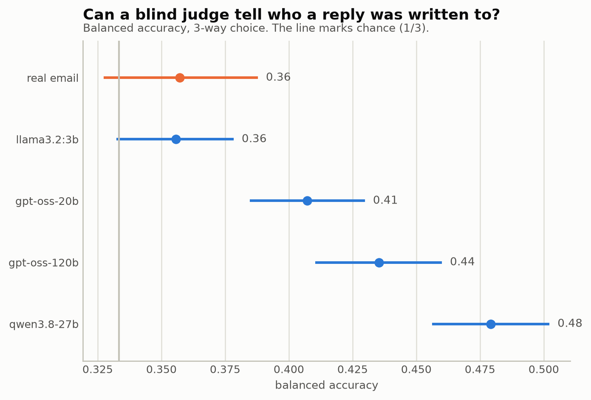

- **Real email sits at chance.** Its interval includes 33%. From one
  real email alone, the judge cannot tell if the writer was senior,
  peer or junior.
- **Llama's replies match real email.** Both are near chance, and the
  difference is about zero (p=.94).
- **gpt-oss replies are easier to read than real email.** gpt-oss-20b is
  5.0 points above real email, gpt-oss-120b 7.8 points. The gain comes
  from lateral and down. Up is no easier than in real email. Down
  replies are easier to spot (31.5% and 34.6%, against 26.3%). This fits
  section 13, where both gpt-oss models give clearly more orders when
  writing down.
- **qwen's replies are the easiest to read: 12.2 points above real
  email.** Almost all of the gain is in "down": the judge spots 76.5%
  of qwen's replies written down, against 26.3% for real email. This
  fits section 13, where qwen has the strongest writing-down effect of
  all models. qwen is not the judge, so self-judging cannot explain it.
- **The judge leans toward "lateral" on every source but qwen.**
  Lateral is the highest hit rate in every other row. A judge that
  says "lateral" when unsure scores well on lateral and badly on up
  and down. For qwen, down is the highest.

**What this means for the plan.** Layer 1 was built to catch generated
email that *lacks* the hierarchy signal real email has. With this judge,
real email shows no signal above chance, so that test cannot fail in
the expected way. What it shows instead: generated replies, when they
differ from real email, carry *more* visible hierarchy, not less. Layer 2
(below) is therefore run on the generated replies too, to see what makes
their hierarchy visible.

**Caveats.**

- **gpt-oss-120b judges its own replies.** Its top score may partly come
  from reading its own style. gpt-oss-20b, a different model of the same
  family, also beats real email, and so does qwen3.8-27b, a different
  family. So the pattern is not only self-judging.
- **The two sides are not the same kind of text.** Real items are whole
  Enron emails. Generated items are replies to a fixed scenario.
- **Real email's labels come from the sender's and receiver's rank**
  (`data/interim/q1_real_emails.parquet`, the real-email benchmark data).
  Wrong ranks would pull real email toward chance.
- **Real email is a sample of 1,000, not all 2,998.** Groq lets through
  only about 250-480 judge calls a day. All 2,998 would have added about
  a week. The sample is random, with a fixed seed and the same
  up/lateral/down mix as the full set, so its accuracy is a fair estimate.
  More emails would mostly narrow the interval. Rounding each
  direction's share gives 1,001.
- **The interval was fixed before this write-up.** The code first put a
  Wilson interval for plain accuracy next to balanced accuracy. These
  differ on real email, whose directions are not balanced. The interval
  and the difference test are now a bootstrap of balanced accuracy (2,000
  resamples, fixed seed).

Source: `python -m thesis.analysis.role_inference --judge-model
openai/gpt-oss-120b@low --real-sample 1000`. Every judge call is cached,
so a rerun makes no API call. Manifest:
`outputs/manifests/role_inference.json`. Figure:
`docs/figures/role_inference_accuracy.png`.

**Layer 2: which cues the judge reads (Oct 22).** Layer 1 says how often
the judge guesses right. Layer 2 asks what in the text makes it guess
"down" or "up". It runs on every source, generated and real, since the
judge reads hierarchy from generated replies even where real email is at
chance.

How: for every email Layer 1 judged, take the judge's guess and measure
six cues on the exact text the judge saw. Then fit one logistic
regression per source: "the judge says down" (and separately "says up")
on the cues. Each cue is standardized within the source, so a number is
the change in log-odds per one standard deviation of that cue.

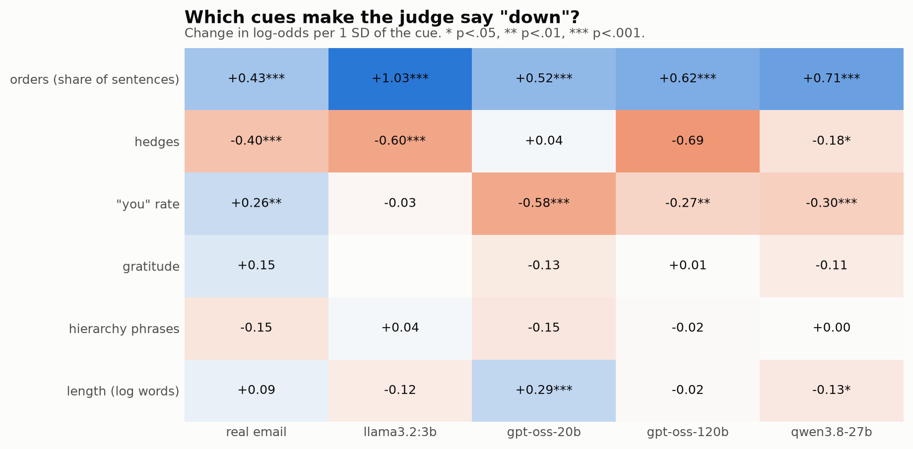
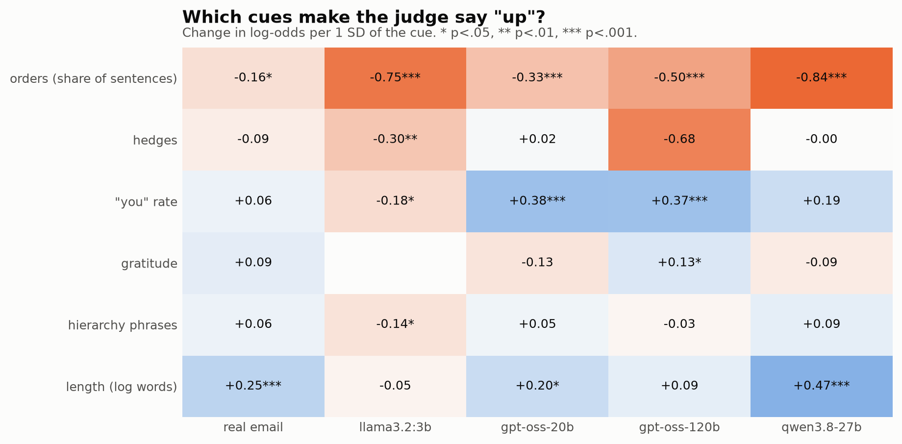

"Judge says down", change in log-odds per 1 SD (* p<.05, ** p<.01,
*** p<.001):

| Cue | Real email | Llama 3.2 3B | gpt-oss-20b | gpt-oss-120b | qwen3.8-27b |
|---|---:|---:|---:|---:|---:|
| Orders (share of sentences) | +0.43*** | +1.03*** | +0.52*** | +0.62*** | +0.71*** |
| Hedges | -0.40*** | -0.60*** | +0.04 | -0.69 | -0.18* |
| "you" rate | +0.26** | -0.03 | -0.58*** | -0.27** | -0.30*** |
| Gratitude | +0.15 | n/a | -0.13 | +0.01 | -0.11 |
| Hierarchy phrases | -0.15 | +0.04 | -0.15 | -0.02 | +0.00 |
| Length (log words) | +0.09 | -0.12 | +0.29*** | -0.02 | -0.13* |

- **Orders are the judge's main cue, on every source.** More orders
  make it say "down" (+0.43 to +1.03), and fewer orders make it say "up"
  (-0.16 to -0.84). This holds for real email too.
- **This explains why qwen is the easiest to read.** The judge's rule is
  "orders mean writing down", and qwen adds the most orders when writing
  down (section 13). So qwen's visible hierarchy is mostly orders.
- **Hedges point to "not down"** in real email and Llama. The gpt-oss
  models almost never hedge, so this cue cannot help there.
- **"you" works in opposite directions.** In real email more "you" goes
  with "down" (+0.26). In gpt-oss and qwen replies more "you" goes with
  "not down" and with "up". So the same word signals different things in
  real and generated writing.
- **Longer emails make the judge say "up"** in real email (+0.25), qwen
  (+0.47) and gpt-oss-20b (+0.20).
- **Gratitude and hierarchy phrases barely move the judge.** No
  significant effect on "down" anywhere.

Caveats.

- These are associations with the judge's guess, not proof of what it
  reasons. The cues are fitted together, so each number is the effect
  with the other cues held fixed.
- One judge (gpt-oss-120b). A different judge may use other cues.
- Standard errors are robust (HC1) but not clustered by persona. Twelve
  tests per source, no multiple-testing correction.
- gpt-oss-120b's hedge number (-0.69) is large but not significant:
  hedges appear in almost none of its replies. Llama never thanks, so
  gratitude is left out for Llama.

Source: `python -m thesis.analysis.role_cues`. It reads every guess from
the cache and calls no model. Manifest: `outputs/manifests/role_cues.json`.

---

## 17. Rubric scores for the three models (Q2, Oct 10)

**Finding.** Judged by one model (llama3.2:3b) on the same six-item rubric
Q3 uses, Llama, gpt-oss-20b and gpt-oss-120b -- the same three models
section 9's embedding classifier compares -- score in a narrow 4.0-4.9 band
(1-5 scale) on every item. Llama scores lowest on every item; the two
gpt-oss models trade off which one is highest depending on the item.
DeepSeek is not part of this table: it is excluded from every new result
in this project, the same decision section 4 of the deck records (still
usable where it was already cached before the cutoff, as in section 18,
but not added to new comparisons).

**How.** The same 60 replies per model from the judge-swap design (section
18), scored by llama3.2:3b alone -- plain means, no model fit, no
self-preference statistic. llama is the judge used here because it is the
one of the three tested judges not caught favoring its own writing (section
18). This answers Q2's question -- does a generated reply look like it
fits its role and situation -- using the rubric's existing items, kept
separate from Q3's question about whether the judge itself can be trusted
(section 18's subject).

**Results**, 60 replies per model (59 for gpt-oss-20b -- one reply did not
parse, the same gap section 18 notes).

Judge = llama3.2:3b:

| Item | Llama 3.2 3B | gpt-oss-20b | gpt-oss-120b |
|---|---:|---:|---:|
| overall rubric mean | 4.28 | 4.63 | 4.62 |
| role_consistency | 4.50 | 4.78 | 4.67 |
| contextual_fit | 4.03 | 4.63 | 4.68 |
| corpus_plausibility | 4.38 | 4.76 | 4.85 |
| clarity | 4.57 | 4.76 | 4.83 |
| politeness_appropriateness | 4.03 | 4.58 | 4.48 |
| conflict_management | 4.18 | 4.27 | 4.18 |

**Extended Oct 12: the other two judges score the same 180 replies very
differently.** The table above uses one judge. Running the same replies
through gpt-oss-20b and gpt-oss-120b as judges -- the same scores section
17 already has cached, just grouped differently -- answers whether the
narrow 4.0-4.9 band above is a property of the replies or a property of
llama as judge.

Judge = gpt-oss-20b:

| Item | Llama 3.2 3B | gpt-oss-20b | gpt-oss-120b |
|---|---:|---:|---:|
| overall rubric mean | 3.60 | 4.53 | 4.56 |
| role_consistency | 2.75 | 4.03 | 4.00 |
| contextual_fit | 2.98 | 4.78 | 4.78 |
| corpus_plausibility | 3.82 | 4.81 | 4.80 |
| clarity | 4.53 | 4.98 | 4.98 |
| politeness_appropriateness | 3.70 | 4.37 | 4.40 |
| conflict_management | 3.80 | 4.20 | 4.40 |

Judge = gpt-oss-120b:

| Item | Llama 3.2 3B | gpt-oss-20b | gpt-oss-120b |
|---|---:|---:|---:|
| overall rubric mean | 3.48 | 4.51 | 4.49 |
| role_consistency | 2.33 | 3.85 | 3.82 |
| contextual_fit | 2.78 | 4.80 | 4.82 |
| corpus_plausibility | 3.87 | 4.85 | 4.82 |
| clarity | 4.53 | 4.98 | 5.00 |
| politeness_appropriateness | 3.83 | 4.47 | 4.40 |
| conflict_management | 3.50 | 4.14 | 4.08 |

**What this means.**

- **The narrow band only holds under llama's own judging.** Under llama as
  judge, all three models sit in a 4.0-4.9 band on every item. Under
  either gpt-oss judge, that band breaks for one model only: llama's own
  replies drop (overall 4.28 under llama's own judging, down to 3.60 under
  gpt-oss-20b and 3.48 under gpt-oss-120b). gpt-oss-20b's and
  gpt-oss-120b's replies stay in roughly the same high band, overall
  4.5-4.6, under every judge, including themselves.
- **The drop concentrates on the same two items section 18 already
  flagged, and for the same reason -- judge severity toward llama, not
  self-preference.** role_consistency goes from llama's own score of 4.50
  down to 2.75 under gpt-oss-20b and 2.33 under gpt-oss-120b.
  contextual_fit goes from llama's own 4.03 down to 2.98 and 2.78. Section
  17's Oct 10 correction already found and explained this exact asymmetry:
  the gpt-oss judges are harsh on llama's writing specifically, and
  llama's own lenient self-judging does not share that harshness. Section
  17 also already flagged why those two items move the most -- the judge
  prompt sends only the reply text, not the role or the original message,
  so role_consistency and contextual_fit cannot really be answered from
  what the judge is given. This section's three-judge table is new, the
  explanation for it is not.
- **So Q2's question -- does a generated reply look plausible and fit its
  role -- does not have one judge-independent answer.** Which judge you
  ask changes the answer for llama's replies. It does not change the
  answer for gpt-oss-20b's or gpt-oss-120b's replies, which stay high under
  every judge tested.
- Under llama as judge specifically: Llama 3.2 3B scores lowest on every
  item, most clearly on contextual_fit and politeness_appropriateness
  (4.03 each); gpt-oss-20b is highest on three items (role_consistency,
  politeness_appropriateness, conflict_management); gpt-oss-120b is
  highest on the other three (contextual_fit, corpus_plausibility,
  clarity), tied with Llama for lowest on conflict_management (4.18).

**Caveats.**

- Three judges now, not independently checked against a person. No reply
  in this project has been hand-coded yet (next-steps item 2).
- One draw per cell, same as every other judge-swap number in this
  project. 60 replies per model, except gpt-oss-20b at 59 (one reply did
  not parse, same gap as above).
- **This disagrees with section 8's word-choice classifier, and that
  disagreement is itself worth noting.** Section 8 flags these same three
  models (among its four) instantly by vocabulary alone (0.84-0.98 AUC,
  full text); here, an LLM judge reading the same kind of reply rates
  `corpus_plausibility` and `contextual_fit` at 2.8-4.9 out of 5 depending
  on which judge is asked. Same models, same underlying Q2 question --
  "does this look real" -- opposite readings depending on whether a
  classifier or an LLM judge is doing the looking. See section 8's own
  note on this for the same point from the other side.

Source: the same `judge_swap_scores_free_tier.parquet` section 18
produces, filtered to `generator != "deepseek-ai/..."`, grouped by
(judge, generator) and averaged per rubric item -- plain means, no model
fit (the model fit is section 18's job). No new API calls.

---

## 18. The judge-swap design on the real free-tier models (Q3, Oct 6)

**Finding.** A judge favors its own kind of model, and this holds on the
project's real four free-tier models, not only the two local stand-ins the
earlier pilot used (PROGRESS.md sections 23, 41, 52). gpt-oss-120b scores
its own replies 0.68 rubric points higher than its normal habits predict.
gpt-oss-20b does the same by 0.59 points. Both p<.0001.

**How.** Four models write replies to the same 60 scenarios (10 personas x
6 scenarios, the design sections 23/41/52 use). Three models then score
every reply, including their own, on the 1-5 rubric. Self-preference is
the interaction term of a `generator x judge` model: how much a model's
own-written-own-judged score sits above what its general writing quality
and its general judging habits already predict, measured against
llama3.2:3b as the baseline for both. Read it as a disagreement between two
judges, not one model's bias alone -- how much more the model's own judge
prefers its writing than llama's judge does.

**DeepSeek could not judge.** NVIDIA retired the DeepSeek model this
project uses mid-session (`deepseek-v4-flash-0731`, end of life
2026-09-21, confirmed by a live HTTP 410 response). Its replies were
already cached from earlier work, so it still writes here. It cannot be
called live any more, so it was dropped as a judge. DeepSeek's own
self-preference is not tested.

**Results**, 239 replies (one gpt-oss-20b reply did not parse and was
dropped), 717 scores.

| Effect | Coefficient | SE | p |
|---|---:|---:|---:|
| gpt-oss-120b self-preference (overall rubric) | +0.681 | 0.123 | <.0001 |
| gpt-oss-20b self-preference (overall rubric) | +0.587 | 0.123 | <.0001 |
| gpt-oss-120b self-preference (corpus_plausibility only) | +0.483 | 0.167 | .004 |
| gpt-oss-20b self-preference (corpus_plausibility only) | +0.618 | 0.168 | .0002 |

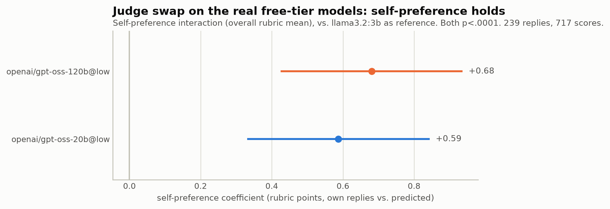

**Correction (Oct 10): the result above is mis-specified.** The interaction
is measured relative to llama3.2:3b as the one reference writer. That choice
turned out not to be neutral.

The code was generalized this session to fit the same interaction on every
individual rubric item, not only `corpus_plausibility` (every judge call
already scores all six; only two were ever being fit). Doing that first:

| Item | gpt-oss-120b | p | gpt-oss-20b | p |
|---|---:|---:|---:|---:|
| overall rubric mean | +0.681 | <.0001 | +0.587 | <.0001 |
| role_consistency | +1.317 | <.0001 | +1.004 | <.0001 |
| contextual_fit | +1.383 | <.0001 | +1.203 | <.0001 |
| corpus_plausibility | +0.483 | .004 | +0.618 | .0002 |
| clarity | +0.200 | .094 | +0.254 | .034 |
| politeness_appropriateness | +0.117 | .498 | +0.130 | .452 |
| conflict_management | +0.583 | .006 | +0.316 | .140 |

Self-preference is far from uniform -- it concentrates in `role_consistency`
and `contextual_fit`. That pattern is what exposed the problem: those are
exactly the two items `build_judge_items` cannot give the judge enough
information to answer. It sends the reply text alone, no role, no original
message -- yet `role_consistency` asks about "the stated role" and
`contextual_fit` asks about "the specific message it is responding to." A
judge scoring those from the reply alone is scoring general writing quality
under a specific-sounding label, not role or context fit.

Re-fitting the identical model with `deepseek-ai/deepseek-v4-flash-0731` as
the reference writer instead -- a model no judge in this grid ever belongs
to, so it cannot produce a self-preference effect by construction -- settles
it:

| Item | gpt-oss-120b | p | gpt-oss-20b | p |
|---|---:|---:|---:|---:|
| overall rubric mean | -0.211 | .086 | -0.241 | .051 |
| role_consistency | -0.050 | .794 | -0.429 | .026 |
| contextual_fit | -0.150 | .511 | -0.231 | .314 |
| corpus_plausibility | -0.533 | .001 | -0.316 | .060 |
| clarity | -0.133 | .264 | -0.080 | .506 |
| politeness_appropriateness | -0.183 | .287 | -0.203 | .239 |
| conflict_management | -0.217 | .308 | -0.184 | .388 |

Every coefficient collapses to roughly zero or goes negative. The cell means
explain why in plain terms: both gpt-oss judges score llama3.2:3b's replies
far below how llama scores itself (`role_consistency` 2.33/2.75 under the
gpt-oss judges against llama's own 4.50; `contextual_fit` 2.78/2.98 against
llama's own 4.03), while scoring DeepSeek's replies about as well as their
own writing, sometimes slightly better (`role_consistency` 3.73/4.22 against
their own-writing scores of 3.82/4.03; `contextual_fit` 4.73/4.83 against
their own 4.82/4.78). **The honest reading: the gpt-oss judges are not
generous to their own writing. They are harsh on llama's writing
specifically, and llama's own lenient self-judging does not share that
harshness.** Measuring self-preference against llama as the one reference
writer mistook that asymmetry for self-preference.

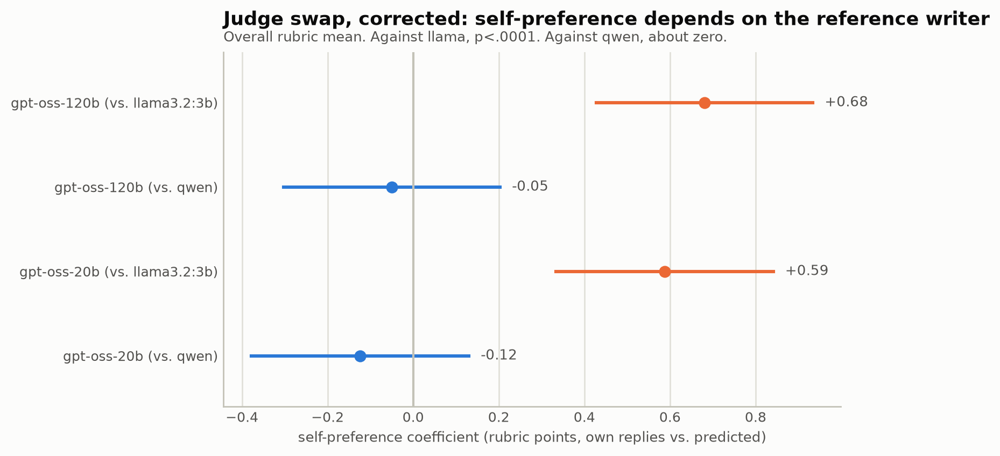

This does not have a clean answer for llama's own self-preference (it still
cannot be measured -- it is always one of the two reference levels here, and
DeepSeek cannot judge to give it a judge-free comparison either), and it does
not revisit the two-local-model pilot (PROGRESS.md section 52): with only
two models there, every writer is also a judge, so no judge-free reference
exists to re-fit against.

The `clarity` row above also needs a second look once more tests are run on
the same table: 14 self-preference tests in the llama-referenced table alone
(7 outcomes x 2 models), not 4. Holm-corrected across those 14 (checked
directly, not estimated), gpt-oss-20b's `clarity` row (p=.034 uncorrected)
needs p<=.010 to survive and does not -- treat it as noise, not an effect.
Every other significance call in the llama-referenced table is unchanged by
the correction. Separately, `clarity` is likely at a ceiling (86% of scores
are a 5), which would mute any real effect there whether or not it is
significant.

Code: `fit_rubric_item_models` (all six items) and a new `--manifest-out`
flag (re-fit the same cached scores against a different `--generators`
reference order without overwriting the primary manifest), both in
`src/thesis/analysis/judge_swap.py`. Re-fit source:
```
python -m thesis.analysis.judge_swap \
  --generators llama3.2:3b openai/gpt-oss-20b@low openai/gpt-oss-120b@low deepseek-ai/deepseek-v4-flash-0731 \
  --judges openai/gpt-oss-20b@low openai/gpt-oss-120b@low llama3.2:3b \
  --analyse-only --manifest-out outputs/manifests/judge_swap_free_tier_deepseek_ref.json
```
Manifests: `outputs/manifests/judge_swap_free_tier.json` (llama-referenced,
now all six items) and `outputs/manifests/judge_swap_free_tier_deepseek_ref.json`
(new, DeepSeek-referenced).

**What this means.**

- **Not safe as stated -- see the correction above.** This bullet originally
  said the real four-model result was "stronger and clearer than the
  two-local-model pilot found" (section 52's +0.40, p=.005, against this
  section's +0.68/+0.59). That comparison assumed both numbers measure the
  same thing. The correction above shows this section's number is mostly
  judge severity toward llama, not self-preference, so the two are not
  comparable as stated. Whether the pilot's own +0.40 has the same problem
  is not checked here -- it would need its own judge-free reference writer,
  which the two-local-model design does not have.
- **This is model-level, not family-level.** gpt-oss-20b and gpt-oss-120b
  are the same family (OpenAI). The design tests whether each favors its
  own exact writing, not whether one favors the other's. (Unaffected by the
  correction -- this is about which models were compared, not the reference
  writer.)
- **The near-zero persona variance did not understate the result.** The
  mixed-model fit logged a singular-covariance warning, the same
  degenerate case sections 33/34/41/52 hit. A cluster-robust OLS refit
  gives the same coefficients (0.681 and 0.587) at the same or slightly
  tighter precision. (Unaffected by the correction -- this is about the
  standard error, not what the coefficient measures.)
- **Not safe as stated -- see the correction above.** This bullet originally
  read the own-family means (4.49 and 4.53, against llama's 4.28) as
  self-preference "adding back" more than harsh general scoring "takes
  away." DeepSeek's replies score just as high under both gpt-oss judges
  (4.52 and 4.58) without any own-family relationship to them, so the
  own-family means being high is not evidence of self-preference either --
  both gpt-oss judges simply rate DeepSeek's and their own writing alike,
  and rate llama's much lower.

**A real bug this surfaced.** Judging with an NVIDIA or Groq model as
judge, never done before in this project, crashed with an unpriced-model
error -- `judge/run.py`'s cost check named the local-model case but not the
free-tier API case. Fixed in the same commit, with a regression test per
provider.

**Recommendation.** For future automated judging in this project, pair
gpt-oss-20b as generator with llama3.2:3b as judge. Both gpt-oss models
write better replies than llama by llama's own judgment (+0.35 and +0.33,
both p<.0001) -- a comparison llama has no stake in, unlike a model
judging itself. (The second half of this recommendation, as originally
written, leaned on gpt-oss "favoring its own writing" -- see the correction
above; that reasoning no longer holds, but the generator-quality numbers
above are unaffected, so the recommendation itself stands on those alone.)
gpt-oss-20b over gpt-oss-120b as generator:
their generator-quality coefficients are close (+0.35 and +0.33, not
tested directly against each other), but gpt-oss-20b runs on NVIDIA's
free tier, not Groq's, so it avoids the daily cap that slowed this very
run and the qwen3.8-27b Q1 run for days.

**Caveats.** One draw per cell. DeepSeek has no self-preference number
(see above). All four p-values survive a Holm correction across the four
tests. Generation cost nothing (all 240 cells already cached); judging
needed 717 live calls, run through the same resumable, backoff-retrying
script the qwen3.8-27b Q1 run uses, since gpt-oss-120b hit Groq's shared
daily cap repeatedly.

Source:
```
python -m thesis.analysis.judge_swap \
  --generators deepseek-ai/deepseek-v4-flash-0731 openai/gpt-oss-20b@low openai/gpt-oss-120b@low llama3.2:3b \
  --judges openai/gpt-oss-20b@low openai/gpt-oss-120b@low llama3.2:3b --design pilot
```
Manifest: `outputs/manifests/judge_swap_free_tier.json`. Prompt hash
`d4c18550ed56f2de`, matching every other current-prompt section.

---

## 19. Does showing the judge the incoming message help? A planned rerun (Q3, Oct 23)

Status: planned, not run yet.

**The problem.** Two rubric items ask about things the judge never sees.

- `contextual_fit` asks if the reply fits the message it answers. The judge
  does not get that message.
- `role_consistency` asks if the reply fits the writer's role. The judge
  does not get the role.

So for these two items the judge scores the reply alone. Its scores may
not mean what the item names say. Section 18 already found that these two
items carry most of the judge disagreement.

**The question.** If the judge also sees the incoming message, does
`contextual_fit` get better at finding bad replies?

**Which replies are bad.** In 100 Llama replies, 25 were coded as
"mirrored": they repeat the request back instead of answering it
(`PROGRESS.md` section 35). A good `contextual_fit` judge should score
these 25 lower than the other 75.

**The test.** Each judge scores the same 100 replies twice:

1. Reply only (the current setup).
2. Reply plus the incoming message.

Then compare the gap between mirrored and sound replies in the two
versions. The gap is tested with a rank-sum test. The shift in every
item's score between the two versions is tested with a signed-rank test,
paired by reply.

**Why run it again.** It was run once in August with qwen2.5:3b as judge
(`PROGRESS.md` section 35). The message raised every score by 0.4 to 0.7,
but the gap did not grow (p=.32 without the message, p=.38 with it). That
judge later failed the self-agreement check (section 16, kappa 0.293), so
the result is weak. This rerun uses the current judges.

**Judges.** gpt-oss-20b (NVIDIA) and gpt-oss-120b (Groq). 200 calls each.

**What we learn.**

- If the gap grows: the fix works. Future judging should include the
  incoming message.
- If the gap does not grow: even strong judges cannot catch mirroring.
  `contextual_fit` scores should be reported with this limit, and only a
  human check can close it.

**Code change needed.** `src/thesis/analysis/judge_blindness.py` only
talks to a local Ollama model. It will reuse `client_for_model` from
`judge_swap.py` to reach NVIDIA and Groq. Output files will carry the
judge's name, so the August result is not overwritten.

**Limits.**

- The 25 "mirrored" codes are Claude's first pass, not a person's.
- Only Llama replies are tested, and only 25 of them are mirrored.
- The role is still not shown to the judge. This test covers
  `contextual_fit` only.

---

## 20. A parallel Q1 experiment: persona variants and new measures (Q1, Oct 15)

This is a second Q1 experiment. It runs next to the existing one and does
not replace it. The two will be compared later.

**Why it is needed.**

- **One persona per role.** The existing design has 10 personas, one per
  role cell (5 ranks x 2 departments, Trading and Legal). A difference
  between ranks could come from that one persona's prompt, not from rank.
- **Too few clusters.** 10 personas means 10 clusters. Cluster-robust
  standard errors need many clusters to be trustworthy (Cameron & Miller
  2015). With 10, they tend to be too small, so p-values look better than
  they are. The persona-clustered p-value in section 12 already jumps
  between draws (p=.248 on draw 1, p=.018 on draw 3).
- **More replies do not fix this.** Extra draws add replies from the same
  10 personas. The number of clusters stays at 10. Only more personas
  fixes it.
- **Narrow measures.** The current Q1 measures are directives, hedges,
  deference, questions and the decision field. Research on power and
  language points to other markers too.

**The new design.** Keep each role cell. Add 3 to 5 persona variants per
cell that differ in traits (for example directness), at the same rank.
This gives 30 to 50 personas. Each reply has a named sender role and a
named receiver role. One reply per email, as before. Each new measure is
first tested on real Enron email. A measure that shows no hierarchy
difference there is dropped before it is used on simulator output.

**Candidate measures.**

| Measure | What it captures | Research | Status |
|---|---|---|---|
| Pronoun rates (I, we, you) | Higher-status writers use less "I" and more "we" and "you" | Kacewicz et al. 2014, *J. Language and Social Psychology* 33(2):125-143 | Tested on real email (below) |
| Hierarchy phrases | 974 weighted phrases that mark email sent up vs. not up the hierarchy | Gilbert 2012, CSCW, pp. 1037-1046 (built on Enron) | Tested on real email (below) |
| Politeness strategies (gratitude, apology, please, greeting) | Politeness drops as status rises | Danescu-Niculescu-Mizil et al. 2013, ACL, pp. 250-259 | Tested on real email (below) |
| Style matching to the incoming email | Lower-status writers match the other person's function-word style more | Danescu-Niculescu-Mizil et al. 2012, WWW, pp. 699-708; Ireland & Pennebaker 2010, *JPSP* 99(3):549-571 | Tested on real email (below) |

**Pronoun rates: result.** Strict benchmark sample, 2,202 emails from 107
senders. Linear mixed model, random intercept per sender, sender rank as a
control. Each effect is measured against writing to a peer. Holm
correction across the six tests.

| Pronoun | Writing down | p | Holm p | Writing up | p |
|---|---:|---:|---:|---:|---:|
| you | +0.0056 | .0015 | .009 | -0.0001 | .966 |
| I | -0.0045 | .052 | .262 | -0.0030 | .144 |
| we | +0.0012 | .428 | 1.000 | +0.0007 | .602 |

Coefficients are the change in the share of words. People use more "you"
when writing down. This survives the correction, so "you" is kept. It is
weaker in the within-sender check (fixed effects, p=.038, Holm p=.191), so
treat it as real but modest. "I" goes the expected way but does not
survive the correction. "We" shows no difference and is dropped.

Limit: the "we" and "you" direction in Kacewicz et al. is confirmed only
from secondary sources so far. The journal page could not be read.

Code: `src/thesis/analysis/q1_measures.py`, run with
`python -m thesis.analysis.q1_measures`. Manifest:
`outputs/manifests/q1_measures_real.json`. No API calls.

**Hierarchy phrases: result.** Same sample, models and correction as the pronoun result: strict sample,
mixed model with sender rank as a control, within-sender fixed effects as
the check, Holm correction within each measure. The score is the sum of the
weights of every listed phrase in an email, per 100 words. 900 phrases with
a nonzero weight were used.

| Score | Writing down | p | Holm p | Writing up | p | Holm p |
|---|---:|---:|---:|---:|---:|---:|
| Mixed model | -0.27 | .571 | .571 | +1.63 | .0001 | .0001 |
| Within-sender check | -0.34 | .634 | .634 | +1.54 | .021 | .041 |

Email written up scores clearly higher. Email written down scores the same
as email to a peer. This is the pattern the list is built for, since it
only separates "up" from "not up". The result holds in both fits, so the
measure is kept.

Limit: Gilbert's list separates "up" from "not up" only. Peer and down
are merged. It was also built from Enron, so a test on our Enron sample is
partly in-sample. The original host is gone, so the list comes from an
archived copy (Wayback Machine) that was not checked against the
original. No license is stated, so the list is not committed to the repo.

**Politeness strategies: result.** Same sample, models and correction as the pronoun result: strict sample,
mixed model with sender rank as a control, within-sender fixed effects as
the check, Holm correction within each measure. Each strategy is scored 1 if
any sentence of the email uses it, else 0. Coefficients are the change in
the share of emails.

| Strategy | Writing down | p | Holm p | Writing up | p | Holm p |
|---|---:|---:|---:|---:|---:|---:|
| Gratitude | +0.111 | .0001 | .0005 | -0.033 | .181 | .723 |
| Apology | -0.004 | .731 | 1.000 | -0.017 | .069 | .415 |
| Please | +0.051 | .035 | .242 | -0.026 | .213 | .723 |
| Greeting | -0.004 | .713 | 1.000 | -0.014 | .106 | .527 |

Only gratitude passes. People thank more when writing down: 36% of such
emails against 29% to a peer. This is the opposite of "politeness drops as
status rises". A likely reason is that managers thank their staff for work
done. It is weaker in the within-sender check (p=.027, Holm p=.189), so
treat it as modest. Apology, please and greeting show no difference after
the correction and are dropped.

Limit: hedges and deference already exist as measures, so only gratitude,
apology, please and greeting are new. The published tool (ConvoKit) did
not install in this project before, so these would be simple word
matches, not the published implementation.

**Style matching: result.** Same sample, models and correction as the pronoun result: strict sample,
mixed model with sender rank as a control, within-sender fixed effects as
the check, Holm correction within each measure. Only replies can be scored, because
the measure needs the email being answered: 664 replies from 93 senders.
The answered email is the message just before the reply in its thread.
The score runs from 0 (no match) to 1 (same function-word style).

| Score | Writing down | p | Holm p | Writing up | p | Holm p |
|---|---:|---:|---:|---:|---:|---:|
| Mixed model | +0.064 | .013 | .027 | +0.043 | .054 | .054 |
| Within-sender check | +0.066 | .038 | .076 | +0.071 | .057 | .076 |

Replies up and down both match the incoming email a little more than
replies to a peer. The 2012 theory predicts more matching up and less
matching down. The "down" result goes against it. Only the "down" effect
in the mixed model survives the correction, and nothing survives in the
within-sender check. This measure is weak and does not follow the theory,
so it is not kept.

Limit: the 2012 measure needs many exchanges between the same two people.
It cannot score one email. The per-email version (Language Style Matching)
needs function-word lists. The standard lists (LIWC) are licensed, and no
validated open list was found. Here the categories come from spaCy
part-of-speech tags plus short word lists, which is an approximation of
LIWC. The message before a reply in a thread is not always from the
person the reply is sent to.

**Pilot results (Oct 25).** 40 personas, 832 cells per model. Two of
four models are done. gpt-oss-120b and qwen are still running.

Orders: log-odds that a sentence gives an order, against writing to a
peer. Persona fixed effects, standard errors clustered by persona. The
10-persona rows are from section 13. Real email is the robust fit from
section 15.

| Model | Design | Valid replies | Writing down | p | Writing up | p |
|---|---|---:|---:|---:|---:|---:|
| Llama 3.2 3B | 40 personas | 832 of 832 | -0.148 | .22 | -0.100 | .46 |
| Llama 3.2 3B | 10 personas | 4,320 | +0.127 | <.001 | -0.009 | .82 |
| gpt-oss-20b | 40 personas | 823 of 832 | +0.009 | .90 | -0.064 | .37 |
| gpt-oss-20b | 10 personas | 1,428 | +0.258 | <.001 | +0.005 | .95 |
| Real email | | 2,202 | +0.253 | <.001 | +0.072 | .40 |

New measures, against writing to a peer. Real email is from the tests
above.

| Measure | Real email | Llama 3.2 3B | gpt-oss-20b |
|---|---|---|---|
| "you" rate | More when writing down | No difference | More when writing down (p=.04) |
| Hierarchy phrases | More when writing up | More when writing down (p=.004); up not significant (p=.07) | More when writing down (p=.04) |
| Gratitude | More when writing down | Not testable: no reply thanks anyone | No difference |
| Hedges | No difference | Fewer when writing down (p=.006) | No difference |

Trait check, effect on the share of sentences that are orders:

- Llama: internal-hire personas give fewer orders (-0.069, p<.001).
  Tenure has no effect.
- gpt-oss-20b: 2-year personas give slightly more orders than 12-year
  personas (+0.030, p=.04). Origin has no effect.

**Llama 3.2 3B.** The rank effect on orders is gone with 40 personas. The
sign even flips, though it is not significant. Its replies are very short
(median 20 words), so gratitude cannot be measured. None of the new
measures matches real email.

**gpt-oss-20b.** In the 10-persona design it matched real email exactly on
orders writing down. With 40 personas that effect is about zero. "you" is
the one new measure that matches real email. Hierarchy phrases go the
wrong way: more when writing down, where real email has more when writing
up.

**What this means so far.** For both models, the 10-persona rank effect
does not hold up with 40 personas. So it probably came from the few
persona prompts, not from rank. This is the risk this design was built to
check. Caveat: each pilot has 832 replies against 1,428 to 4,320 in the
10-persona runs, so it has less power.

Manifests: `outputs/manifests/q1_personas_{llama,gpt_oss_20b}_pilot.json`.

---

## 21. Where the code lives

**The clients.** `src/thesis/llm/openai_compatible.py` holds the shared
request and retry logic. `nvidia_client.py` and `groq_client.py` are thin
subclasses. `base.py` lists `"nvidia"` and `"groq"` as providers, and
`sim/run.py` never bills either one. `.env.example` documents both key
names; the real keys live only in `.env`, which git ignores.

**The mirroring fix.** `analysis/mirroring.py`'s `pair_key` matches two runs
by persona and message rather than by the model's role label, so two
different models answering the same email can be compared at all.
`compare_runs` also runs the same-length comparison and saves it in the
manifest.

**The Q1 backend.** `analysis/q1.py` takes `--local MODEL`, `--nvidia MODEL`,
`--groq MODEL`, or `--grid PATH` to analyse an existing file without calling
any model, plus `--compare-real` to print the comparison against the
real-email benchmark in one command. `analysis/q1_real.py`'s `implied_se` is
public so both modules share one formula.

**The model comparison.** `analysis/q1_models.py` takes one `--grid
LABEL=PATH` per model and writes one manifest and one figure, named by
`--manifest` and `--figure-prefix`. It calls no model. Its grid loader used
to mark every row "from cache" regardless of how the grid was actually
generated -- fixed, commit `36fbc3e`. One small gap remains: each grid it
loads now carries a `prompt_text_hash` (commit `5ee4b46`), but
`q1_models.py`'s own output manifest (the JSON this command writes) does not
copy that hash into its per-model entries yet, so checking a grid's prompt
still means opening the grid file itself rather than the comparison
manifest.

```
python -m thesis.analysis.q1 --nvidia openai/gpt-oss-20b@low \
  --out data/interim/q1_direction_grid_gpt_oss_20b.parquet
python -m thesis.analysis.q1 --groq openai/gpt-oss-120b@low \
  --out data/interim/q1_direction_grid_gpt_oss_120b.parquet
python -m thesis.analysis.q1_models \
  --grid "Llama 3.2 3B=data/interim/q1_direction_grid_llama_act.parquet" \
  --grid "DeepSeek V4 Flash=data/interim/q1_direction_grid_deepseek.parquet" \
  --grid "gpt-oss-20b=data/interim/q1_direction_grid_gpt_oss_20b.parquet" \
  --grid "gpt-oss-120b=data/interim/q1_direction_grid_gpt_oss_120b.parquet" \
  --figure-prefix q1_models_all_ --manifest outputs/manifests/q1_models_all.json
```

Exact commits and the day-by-day build order, including two corrections
made along the way, are in `PROGRESS_nvidia.md`.

---

## 22. Next steps

Most valuable first.

Done since this list was written: these three code fixes cover what used to
be items 1 and 3 here (item 3 bundled two separate fixes).

- **The sentence-level p-value now has a persona-clustered cross-check.**
  `Q1Result.sentence_model_persona_fe` fits `is_imperative ~ direction` a
  second way, by persona-clustered fixed effects, next to the
  variational-Bayes fit that understated uncertainty. `q1_models.py` reports
  the clustered coefficient/p/interval as the headline numbers now, with the
  VB ones kept alongside as `coefficient_vb`/`p_vb`. Commit `85e833a`. The
  four-model table and figure in the Q1 section above are now regenerated
  with this fit. The "vs real email" tables further up that section still
  use the older VB fit -- rewriting those, and the length-matched
  comparison, are separate, larger steps (see items below).
- **The prompt hash is now written into every saved Q1 grid.** `Q1Grid`
  carries `prompt_text_hash`, also saved as a column on the grid's parquet
  file, so a saved grid records which prompt made it instead of needing a
  by-hand check. A grid saved before this fix reads back as `"unknown"`
  rather than raising. Commit `5ee4b46`. The one gap this left -- a
  model's own row in `q1_models.py`'s output manifest did not carry this
  hash, so checking it meant opening the grid file -- is also closed now:
  `summarize_model`'s row carries `prompt_text_hash` too. All three models
  in `q1_models_full.json` confirm the same hash (`d4c18550ed56f2de`).
- **`q1_models.py`'s grid loader no longer marks every row "from cache".**
  `load_grid` now counts the real split from the `from_cache` column every
  row already carries, instead of hard-coding `n_from_cache=len(frame)`.
  Commit `36fbc3e`.
- **The main Q1 run (Llama, local, full design) now shows the writing-down
  effect at a normal significance level** -- 4,320 replies overnight,
  p=.002 (VB) / p=.0006 (persona-clustered). See "12. The main Q1 run
  reaches significance (Q1, Sep 23)" above.
  Llama specifically; it does not cover the other three models (next item).
- **`draw_stability.grid_draw_reliability` now handles any number of
  draws.** It used to require exactly draws 1 and 2 and raised otherwise,
  found when the main Q1 run's third draw hit it. Generalized each of its
  three statistics to the standard multi-rater form (proper ICC, mean
  pairwise correlation, Fleiss' kappa), unchanged at exactly two draws.
  Commit `a9ae1d2`. `run_q1_analysis` now runs on the 3-draw grid without a
  workaround; see "12. The main Q1 run reaches significance (Q1, Sep 23)"
  above for the reliability numbers this produced.
- **`grid_contrasts` and `contrast_estimates` now use the pooled fit for a
  multi-draw grid.** Both always read the draw-1-only fits, so the CLI's
  "Against real email" table, the "Precision" table, and the manifest's own
  `primary`/`precision` sections silently used a third of the 3-draw
  grid's data. Found independently by a second Claude session cross-checking
  this file. See "12. The main Q1 run reaches significance
  (Q1, Sep 23)" above for what changed and what didn't (the effect's own
  significance did not move; the "smaller than real email" comparison did).
- **The Q1-versus-real comparison now has a length-matched version.** See
  "14. Length-matching the Q1-vs-real comparison (Q1, Oct 4)" above. Covers what
  used to be item 1 here. It found that gpt-oss-120b's "overshoot" is no
  longer detectable once both sides are cut to the same reply length, and
  also exposed a separate problem (see the next item).
- **`mirroring.py`'s `--compare-to` summary key is renamed.** It saved its
  comparison under `compared_with_previous_prompt`, the wrong name since
  `compare_runs` compares any two runs -- two prompt versions or two
  models. Now `compared_with_run`. Nothing reads the old key
  programmatically, so this is code-only; the four manifests already saved
  under the old name (`mirroring_gpt_oss.json`,
  `mirroring_gpt_oss_120b.json`, `mirroring_deepseek.json`,
  `mirroring_act.json`) are left as they are, historical artifacts of the
  code at the time, not regenerated.
- **The real-email fit now has a robust-standard-error cross-check, and
  the model-vs-real comparisons use it.** See "15. A robust standard-error
  check for the real-email fit (Q1, Oct 5)" above. Covers item 1 here.
  gpt-oss-120b's "significantly bigger than real email" claim (old
  p=.009) is not significant under the robust fit (p=.084) -- combined
  with the Oct 4 length-matching finding, its overshoot story is now
  unsupported either way. Llama and gpt-oss-20b's conclusions did not
  change. Two open limitations noted there: the model-side robust fit has
  only 10 clusters, and the length-matched robust fit drops more senders
  than its VB version did.
- **The embedding map now covers the three free-tier models, not only
  Llama.** See "9. Do generated replies look like real email in
  meaning-space? (Q2, Oct 5)" above. Covers the embedding-map half of what
  used to be item 4 here. The
  free-tier models' separability AUC (0.904 to 0.932) is not lower than
  Llama's (0.890); for Llama, length explains most of the gap, for the
  three free-tier models it explains almost none.
- **The judge-swap design now covers the project's real four free-tier
  models, not two local stand-ins.** See "18. The judge-swap design on the
  real free-tier models (Q3, Oct 6)" above. Covers item 4 here.
  gpt-oss-120b and gpt-oss-20b both show self-preference against llama as
  reference (+0.68 and +0.59, both p<.0001), stronger than the two-local-
  model pilot found. DeepSeek could not be tested as judge: NVIDIA retired
  the model this project uses mid-session.

1. **A larger sample would help the two remaining NVIDIA/Groq models too.**
   Every simulator interval in the four-model figure is 0.5 to 0.7 wide,
   against 0.2 for real email's 2,202 emails -- true for gpt-oss-20b and
   gpt-oss-120b still, now that Llama's own version of this question is
   answered above. DeepSeek is no longer a candidate here: NVIDIA retired
   the model this project uses (see section 18), so its 240 cached replies
   are fixed in place and cannot be enlarged. gpt-oss-120b's Groq rate cap
   (200,000 tokens/day) makes this a multi-day job there, not an overnight
   one.
2. **Hand-code a sample of replies by a person.** The mirroring cutoff and
   its validation rest on Claude's first-pass codes of Llama replies only.
   A coding page is already built and committed (`review_pack.py`, commit
   `50bd3aa`): 50 emails, two replies each from two models, in random
   order, with the model hidden. The codebook's missing `wrong_register`
   definition is also already fixed. Nothing left but a person to sit down
   and code it. This session built three more such packets, one per
   free-tier model (`outputs/tables/{gpt_oss,gpt_oss_120b,deepseek}/
   manual_review_sheet.csv` and `manual_review_packet.md`, gitignored
   prep material, not committed). This is the review-pack half of what
   used to be item 4 here. Like the Llama-vs-DeepSeek packet above, no
   one has coded these yet, so they produce no citable numbers so far.
3. **A run without the act instruction.** This would show whether a larger
   model follows the instruction better than the small local one did
   (`PROGRESS.md` section 43 found only a small effect on Llama). The code
   already has a `--prompt-variant` mechanism; a third variant without the
   instruction would fit it.
4. **Move the line-removal rule into the corpus cleaner**, so every analysis
   uses the same clean real-reply text instead of a one-off script.
5. **Back up `runs/_cache`.** It holds every reply this project has
   received and exists only on this laptop. It must never go into git,
   because the prompts contain Enron text.
